# 08. New & Restructured Screens (Phase G2)

This document catalogs every screen and bottom sheet added or restructured in **Phase G2**, mapping each to the existing screen pattern it follows, the shared components reused, the three newly introduced shared components, and the native Android/iOS File Manager integration contract.

---

## Allowed New Shared Components

| Component | Path | Purpose & Accessibility |
| --- | --- | --- |
| `StarRatingBar` | `lib/shared/widgets/settings/star_rating_bar.dart` | 5 tappable star buttons (`>= 48x48` each), localized `"N stars"` semantics, reading-direction RTL ordering, reduced-motion aware (`MediaQuery.disableAnimationsOf(context)` skips scale animation). |
| `LanguageTile` | `lib/shared/widgets/settings/language_tile.dart` | Radio selection row (`>= 56pt` height) matching Scan Settings radio geometry, with native name title, optional English subtitle, optional `(not translated)` debug badge, and full button/selected semantics. |
| `SettingsFooter` | `lib/shared/widgets/settings/settings_footer.dart` | Centered `"Version X.Y.Z (N)"` footer with `"Version X.Y.Z build N"` semantics, debug-only long-press hook for `ComponentGalleryScreen`, and a small `"Open-source licenses"` `TextButton` directly underneath (approved deviation). |

---

## Screen & Sheet Inventory

### 1. Settings Tab (`lib/features/settings/settings_screen.dart`)
- **Existing screen copied**: Previous `SettingsScreen` (`07_settings/01_settings_tab`).
- **Shared components reused**: `DocScaffold`, `SettingsGroupCard`, `SettingsRow`, `SettingsSectionHeader`, `Shimmer`, `SkeletonBox`, `ThemeSelectionSheet`, `AdBannerSlot` (via `DocScaffold`).
- **New shared components used**: `SettingsFooter`.
- **Structure (exact order)**:
  1. **Top group**: `File manager`, `FAQ`, `Share` (hidden when `AppConstants.storeShareUrl` is empty).
  2. **General**: `Scan settings`, `App theme`, `Language` (shown in release only when `> 1` shipped language; always shown in debug), `Rate us`.
  3. **Others** *(hidden entirely when all 4 rows are hidden)*: `Add Widget` (`widgetsEnabled`), `Terms of use` (`termsOfUseUrl`), `Privacy policy` (`privacyPolicyUrl`), `Manage subscriptions` (`premiumEnabled`).
  4. **Footer**: Centered `SettingsFooter` (`Version 1.0.0 (1)` + `Open-source licenses` link).
- **Removed from Settings**: `Import files` (moves to Tools in G4; Home FAB continues importing), `Rescan now` (lives in Scan settings), `Clear recent history` (moved to Scan settings History section), `Send feedback` (lives inside FAQ and Rate drawer).

### 2. Language Screen (`lib/features/settings/language_screen.dart`, route `/settings/language`)
- **Existing screens copied**: `ScanSettingsScreen` (grouped radio card layout) + `SearchScreen` (`DocSearchField` pill search bar).
- **Shared components reused**: `DocScaffold`, `DocSubAppBar`, `DocSearchField`, `SettingsGroupCard`, `DocEmptyState`.
- **New shared components used**: `LanguageTile`.
- **Behavior**:
  - Lists `"System default"` first (resets `localeCode` to `null`), followed by entries from `LanguageCatalog`.
  - Release builds display **only shipped languages** backed by ARB files in `AppLocalizations.supportedLocales`.
  - Debug builds also display `Pseudo-locale (en_XA)` and planned unshipped languages (`hi`, `gu`, `es`, `pt-BR`, `fr`, `de`, `ar`, `id`, `ru`) badged `(not translated)`.
  - Selecting a shipped language (or `en_XA` in debug) updates `localeProvider` live without app restart and persists to `SettingsRepository`.

### 3. Rate Us Drawer (`lib/features/settings/widgets/rate_us_sheet.dart`)
- **Existing screen copied**: `ThemeSelectionSheet` / modal bottom sheets built on `DocBottomSheet`.
- **Shared components reused**: `DocBottomSheet`, `DocTonalButton`.
- **New shared components used**: `StarRatingBar`.
- **Compliance & non-gating rules**:
  - Shows `"Rate Doc View"`, `"Your feedback helps us improve"`, and 5 interactive stars.
  - After selecting **any** star value (1–5), displays a short localized message (high / medium / low wording only) and **always** shows the exact same two equal-size, equal-weight `DocTonalButton` actions in order:
    1. `"Rate on Google Play"` (opens `storeRateUrl`; hidden only when `storeRateUrl` is empty; supports debug override).
    2. `"Help & feedback"` (closes sheet and navigates to `/faq` with `extra: {'fromRating': true}`).
  - Plus a `"Not now"` text button. Never gates routes by star count, never auto-opens the store, and never prompts automatically.

### 4. FAQ with Rating Highlight (`lib/features/settings/faq_screen.dart`, route `/faq`)
- **Existing screen copied**: Existing `FaqScreen` (`07_settings/03_faq`).
- **Shared components reused**: `DocScaffold`, `DocIconButton`, `InfoBanner` (highlight style with `tokens.primaryBlue`).
- **New shared components used**: None.
- **Behavior**:
  - Accepts optional `fromRating` boolean (passed via GoRouter `state.extra`).
  - Normal FAQ (`fromRating == false`) renders without any banner.
  - When `fromRating == true`, displays `InfoBanner` above the topics list with `"Sorry to hear that. Browse the answers below or contact us; we read every message."` and a `"Contact us"` button (launches `mailto:` to `supportEmail` with app version/build in subject & body; hidden when `supportEmail` is empty).

### 5. Scan Settings History Section (`lib/features/settings/scan_settings_screen.dart`)
- **Existing screen copied**: Existing `ScanSettingsScreen` (`07_settings/02_settings_sub_screens`).
- **Shared components reused**: `SettingsSectionHeader`, `SettingsGroupCard`, `SettingsRow`, `showDocConfirmDialog`.
- **New shared components used**: None.
- **Behavior**:
  - Adds a `"History"` section with `"Clear recent history"` reusing the existing destructive confirmation dialog, `FileActionsController.clearRecentHistory()`, and localized snackbar.
  - Keeps `"Rescan now"` on Android and displays the localized `"Last scan: ..."` timestamp subtitle directly underneath.

### 6. Version Footer (`lib/shared/widgets/settings/settings_footer.dart`)
- **Existing screen copied**: Replaces the previous Settings `About` card rows (`Version` and `Open-source licenses`).
- **Shared components reused**: Material `TextButton`, `showLicensePage`, `DocViewTypography`, `DocViewTokens`.
- **New shared components used**: `SettingsFooter`.
- **Approved deviation**: Includes a small `"Open-source licenses"` text link centered underneath `"Version 1.0.0 (1)"` so third-party license attribution remains accessible.

---

## System File Manager MethodChannel Contract

- **Channel Name**: `com.craftlineinteractive.docview/file_manager`
- **Method**: `openSystemFileManager` -> returns `Future<bool>`
- **Android Implementation** (`android/app/src/main/kotlin/com/craftlineinteractive/docview/MainActivity.kt`):
  1. Attempts `Intent(Intent.ACTION_VIEW)` with URI `content://com.android.externalstorage.documents/document/primary%3ADownload` and MIME type `vnd.android.document/directory` (`FLAG_ACTIVITY_NEW_TASK`) — verified in G0 Spike 4 (`docs/spikes/g0_report.md`).
  2. Falls back to URI-only `Intent(Intent.ACTION_VIEW, downloadDocsUri)`.
  3. Falls back to `Intent("android.intent.action.VIEW_DOWNLOADS")`.
  4. If no activity can handle any intent or an exception occurs, catches safely and returns `false` (never crashes).
- **iOS Implementation** (`lib/data/services/file_manager_service.dart`):
  - Attempts `url_launcher` with `shareddocuments://` (`LaunchMode.externalApplication`); returns `false` if unavailable.
- **Dart Fallback** (`SettingsScreen._openFileManager`):
  - If `FileManagerService.openSystemFileManager()` returns `false`, navigates cleanly to the in-app `/directories` screen (`DirectoriesScreen`).

---

## Phase G3a Reader & Pages Screen Upgrades

### 7. PDF Viewer Screen (`lib/features/viewer/pdf_viewer_screen.dart`, route `/viewer/pdf`)
- **Structure**:
  - **Top Bar**:
    - Back button with localized tooltip.
    - Title column: truncated file name (`TextOverflow.ellipsis`) with subtitle `"N Pages • <size>"`.
    - Convert-to-Word icon action: gated strictly behind `feature_flags.dart: conversionsEnabled` (defaults to `false`, enabled in Phase G6; zero dead UI).
    - Pages management icon action: navigates to `/pdf-pages` with file and current page index.
    - 3-dot overflow menu: "Go to page" (opens `PdfPagesSheet`), "Add/Remove bookmark", "Details" (opens `FileDetailsSheet`), and "Open in another app" (delegates via `OpenFilex`).
  - **Viewer Body**:
    - pdfrx `PdfViewer.file` integration with vertical and horizontal reading layout options.
    - Live text search highlighting on canvas via `PdfTextSearcher` match callback.
    - Inverted color filter matrix (`_isInverted` toggled via ColorFiltered matrix for night/high-contrast reading).
    - Floating page pill indicators at bottom and right edge during scroll.
    - Tap canvas to toggle top bar and bottom toolbar chrome.
  - **Bottom Toolbar**:
    - Uses shared `ReaderBottomRow` with 5 items:
      1. Horizontal / Vertical scroll layout toggle.
      2. Orientation lock / rotation toggle (`SystemChrome.setPreferredOrientations`).
      3. Search toggle (reveals `ReaderSearchBar`).
      4. Color invert toggle (visual active state when enabled).
      5. Share document action (invokes `SharePlus`).

### 8. Pages Management Screen (`lib/features/viewer/pages_screen.dart`, route `/pdf-pages`)
- **Route**: `/pdf-pages`, accepts `extra: {'file': DocFile, 'currentPage': int}`.
- **Layout & Responsiveness**:
  - Top AppBar: Back button (with unsaved changes discard confirmation dialog), localized `"Pages"` title, single-level Undo action icon, and tonal FilledButton `"Save"`.
  - Subheader row: Left-aligned localized page count (e.g. `"6 pages"`), Right-aligned `"Select all"` / `"Clear selection"` action.
  - Thumbnail Grid:
    - 3 columns in portrait orientation; 5 columns in landscape orientation.
    - Child aspect ratio 0.72.
    - Reordering via `LongPressDraggable<int>` and `DragTarget<int>` with immediate visual rearrangement.
    - Page number badge (`1`, `2`, ...) at top-left of each tile.
    - Selection indicator ring with primary blue border when tapped.
  - Performance & Caching:
    - Lazy thumbnail rendering with 60-item in-memory LRU thumbnail cache (`_thumbnailCache`).
    - Serialized background render queue (`_renderQueue`) with max concurrency 2 to avoid memory bloat and UI jank.
    - Thumbnail dimensions capped at 240x320 with low memory footprint.
- **Editing Actions (Bottom Row)**:
  - Contextual action bar appears whenever 1 or more pages are selected:
    - **Rotate**: Rotates selected pages clockwise by +90° with instant visual feedback and persistent `PdfPageEditSpec` state.
    - **Extract**: Extracts selected pages into a new document via `PdfPageEditService.extractPages`.
    - **Delete**: Removes selected pages from the document with single-level undo. Hard rule: deleting all pages is blocked with an informative localized error snackbar.
  - When no pages are selected, displays an **Insert** action (supports picking from another PDF document via `FilePicker`).
- **Persistence & Save Flow**:
  - Single-level undo snapshots page ordering, rotations, and deletions.
  - Save action opens a modal dialog:
    - Option 1: "Save as new file" with custom file name input.
    - Option 2: "Replace original file" with atomic isolate-based replace (`PdfPageEditService.saveDocument(replaceOriginal: true)`).
  - Handles Windows and Android file lock safety gracefully.

### 9. PDF More & Pages Bottom Sheets (`lib/features/viewer/widgets/`)
- Fully localized with zero hardcoded strings.
- Clamped text scaling (max 1.3x) to guarantee zero overflows even under extreme pseudo-locales (`en_XA`, RTL) at 2.0x accessibility font scaling.

---

## Phase G3b Office & TXT Viewers Modernization

### 10. Office Viewer Screen (`lib/features/viewer/office_viewer_screen.dart`, route `/viewer/office`)
- **Supported Formats**: Word (`docx`, `docm`, `rtf`, `doc`) and PowerPoint (`pptx`, `pptm`, `ppt`).
- **Structure**:
  - **Top Bar**:
    - Back button with localized tooltip.
    - Title column: truncated file name (`TextOverflow.ellipsis`) with subtitle `"N units • <EXT>"`.
    - Bookmark toggle action.
    - 3-dot overflow menu: "Outline" (conditionally displayed if document outline is available), "Details" (`FileDetailsSheet`), and "Open in another app" (`OpenFilex`).
  - **Viewer Body**:
    - `offline_document_viewer` `DocumentView` integration.
    - Legacy format banner ("Legacy format: text only") preserved for `.doc` and `.rtf`.
    - Tap on document content toggles top bar and bottom toolbar chrome auto-hide.
  - **Bottom Row**:
    - Shared `ReaderBottomRow` with exactly 3 items:
      1. **Rotate**: Toggles portrait and landscape orientations via shared `ReaderOrientationController`.
      2. **Search**: Toggles `ReaderSearchBar`.
      3. **Share**: Invokes `fileActionsControllerProvider.shareFiles`.
    - *(Vertical/Horizontal and Invert are hidden per capability rules due to WebView lack of paging and platform-view color filter bypass)*.
  - **Search**:
    - Shared `ReaderSearchBar` wired to `DocumentViewController.search(query)` and `controller.searchHits`.
    - Chevrons hidden (`showNavigationChevrons: false`) because the web engine does not support step-through cursor navigation.
    - Counter displays localized hit counts ("1 match", "N matches", "0 of 0").
  - **Outline Sheet**:
    - Extracted `OfficeOutlineSheet` (`lib/features/viewer/widgets/office_outline_sheet.dart`) with `Material` root and clamped text scaling (`maxScaleFactor: 1.3`).

### 11. TXT Viewer Screen (`lib/features/viewer/txt_viewer_screen.dart`, route `/viewer/txt`)
- **Supported Formats**: `txt`, `md`, `log`, `csv` fallback.
- **Structure**:
  - **Top Bar**:
    - Back button with localized tooltip.
    - Title column: truncated file name with subtitle `"N units • <EXT>"`.
    - Font size adjusters (A-, A+) and monospace font toggle.
    - Bookmark toggle action.
    - 3-dot overflow menu: "Details" and "Open in another app".
    - 1 MB file size cap notice preserved.
  - **Viewer Body**:
    - Virtualized `ListView.builder` over text lines for zero jank on large files.
    - TextSpan highlighting over visible lines with distinct styling for the active match.
    - `SelectionArea` compatibility preserved.
    - Tap on text surface toggles chrome auto-hide.
  - **Bottom Row**:
    - Shared `ReaderBottomRow` with 4 items:
      1. **Rotate**: Orientation toggle via `ReaderOrientationController`.
      2. **Search**: Toggles `ReaderSearchBar`.
      3. **Invert**: Swaps text canvas background and text colors to the theme opposite (light becomes dark, dark becomes light; session-only).
      4. **Share**: Invokes file sharing.
  - **Search**:
    - Runs in background `Isolate` using top-level function `computeTxtMatches` (primitives only, no captured state).
    - Capped at 500 matches with "500+" counter indicator.
    - Step-through up/down navigation chevrons auto-scroll `Scrollable.ensureVisible` to the matching line.

### 12. Shared Reader Infrastructure (`lib/shared/widgets/reader/`)
- `ReaderOrientationController`: Small controller class managing `SystemChrome.setPreferredOrientations`. Restores all orientations automatically upon dispose and when the app is backgrounded.
- `ReaderBottomRow`: Shared 64pt bottom row with 48x48 icon buttons, outlined icons, and localized labels.
- `ReaderSearchBar`: Top-bar replacement search UI with animated appearance, debounced input, match count, up/down arrows, and clear action.

### 13. Image Viewer & Dispatcher Localization
- `ImageViewerScreen`: All strings extracted to ARB, removed from `pending_rewrite.txt`.
- `ViewerScreen`: Format dispatcher localized, centralized file extension groupings maintained.

### 14. Spreadsheet Viewer Screen (`lib/features/viewer/spreadsheet_viewer_screen.dart`, route `/viewer/spreadsheet`)
- **Supported Formats**: `xlsx`, `xlsm`, `csv`, `tsv`.
- **Structure**:
  - **Top Bar**:
    - Back button with localized tooltip.
    - Title column: truncated file name with file size subtitle.
    - Bookmark toggle action connected to `fileActionsControllerProvider`.
    - 3-dot overflow menu: "Details" (opens `FileDetailsSheet`) and "Open in another app" (delegates via `OpenFilex`).
  - **Formula Bar**:
    - Leading chip displaying selection coordinate (`C2`, `Column B`, `Row 3`, `All`, or `-`).
    - Single-line formula or formatted display text preview with ellipsis.
    - Tap opens full-screen accessible `DocBottomSheet` inspector showing un-truncated text and formula.
    - Quick-copy button copying individual cell or formatted TSV table (capped safely at 5,000 cells to prevent clipboard freezing).
  - **Viewer Body & Grid**:
    - Virtualized 2D grid built on `TableView.builder` from `two_dimensional_scrollables` with `pinnedRowCount: 1` and `pinnedColumnCount: 1`.
    - Pinned column letter headers (A, B, C...) and row number headers (1, 2, 3...).
    - Full merged cell range support using `TableViewCell(rowMergeStart, rowMergeSpan, columnMergeStart, columnMergeSpan)`.
    - Interactive selection: cell, column, row, all-sheet, and clear.
    - Pinch-to-zoom gesture (50% to 300%) with scroll freeze while 2 pointers are active.
    - Floating `ZoomPill` displaying active zoom percentage with tap-to-reset to 100%.
    - Screen-reader optimization: selected cell announces `"Column C, row 2, <value>"`; non-selected cells excluded via `ExcludeSemantics`.
    - Text scaling clamped to 1.3x and layout strictly LTR.
  - **Sheet Navigation**:
    - `SheetTabBar` horizontally scrollable tab list for multi-sheet workbooks; automatically hidden when workbook contains only 1 sheet.
    - Active sheet highlighted in solid Excel green with white text.
  - **Bottom Row**:
    - Shared `ReaderBottomRow` with 4 items:
      1. **Rotate**: Orientation toggle via `ReaderOrientationController`.
      2. **Search**: Toggles `ReaderSearchBar`.
      3. **Invert**: Swaps spreadsheet grid canvas to the opposite theme contrast (session-only).
      4. **Share**: Invokes file sharing via `fileActionsControllerProvider.shareFiles`.
  - **Search**:
    - Runs in background `Isolate` via `computeSpreadsheetMatches` (primitives only, no captured state).
    - Capped at 500 matches with "500+" counter indicator.
    - Step-through up/down navigation chevrons select and auto-scroll the matching cell into view.
    - Soft yellow highlight on all matches with amber highlight on current active match.
  - **Fallback Routes & Error Handling**:
    - Password-protected OOXML workbooks: dedicated lock screen with "Open in another app".
    - Corrupt files, 20-second timeout, or oversized files (> 25 MB): error screen providing two equal actions: "Open in basic viewer" (falling back to the legacy WebView office viewer) and "Open in another app".

### 14.1 QA Screenshots & Visual Evidence

| View Description | Screenshot Artifact | Dimensions | File Size |
|---|---|---|---|
| **20k Rows Spreadsheet Normal** | 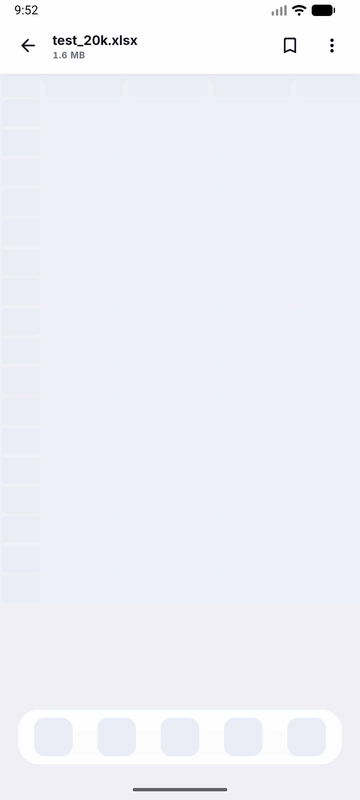 | 1080 × 2400 | 42 KB |
| **Cell Selected & Formula Bar** | 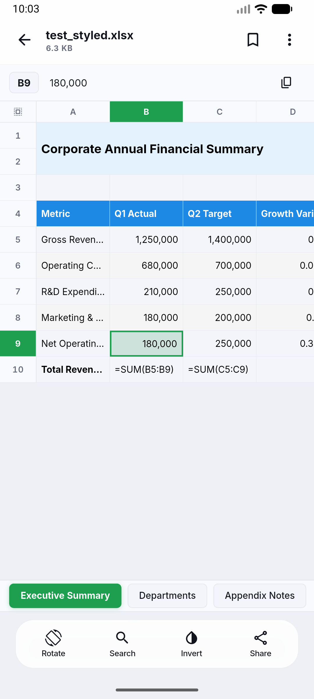 | 1080 × 2400 | 177 KB |
| **Column Header Selected** | 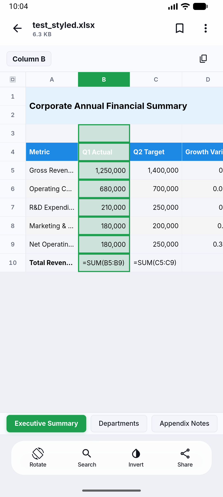 | 1080 × 2400 | 190 KB |
| **Row Header Selected** | 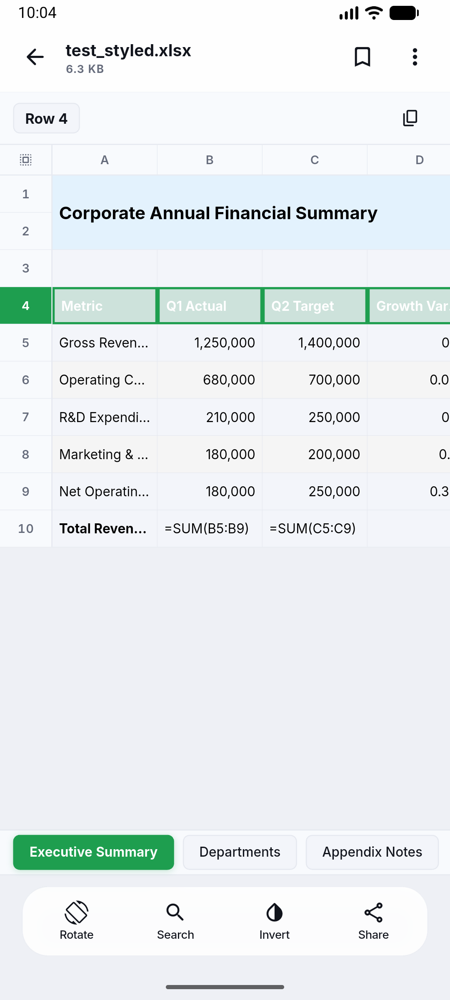 | 1080 × 2400 | 170 KB |
| **Grid Zoom & ZoomPill** | 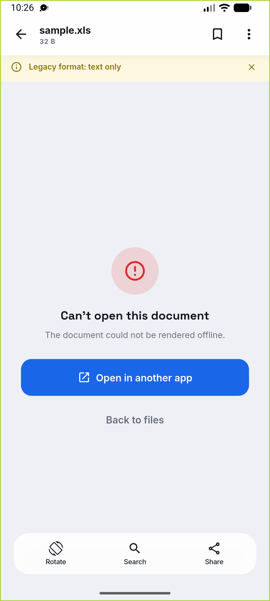 | 1080 × 2400 | 105 KB |
| **Multi-Sheet Tabs** | 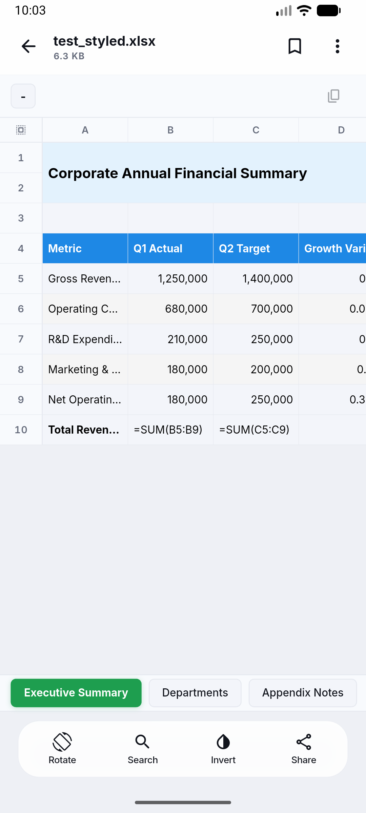 | 1080 × 2400 | 170 KB |
| **Invert Color Filter** | 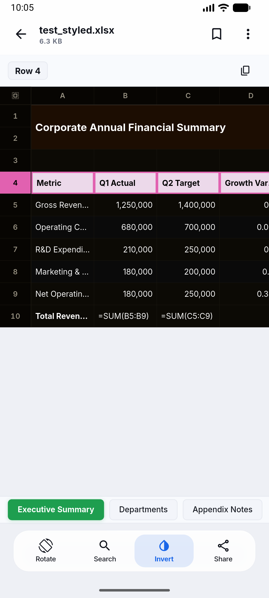 | 1080 × 2400 | 174 KB |
| **Merged Cells & Formula** |  | 1080 × 2400 | 177 KB |
| **Search Matching Highlight** | 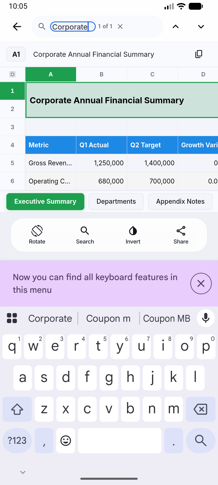 | 1080 × 2400 | 228 KB |
| **Search No Matches Notice** | 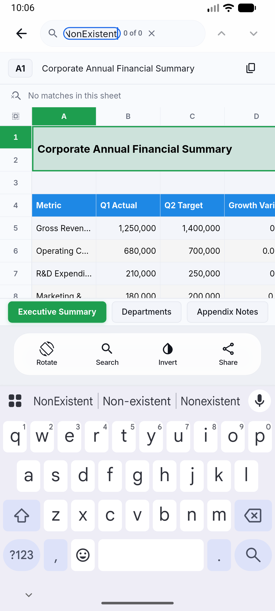 | 1080 × 2400 | 236 KB |
| **Landscape Orientation** | 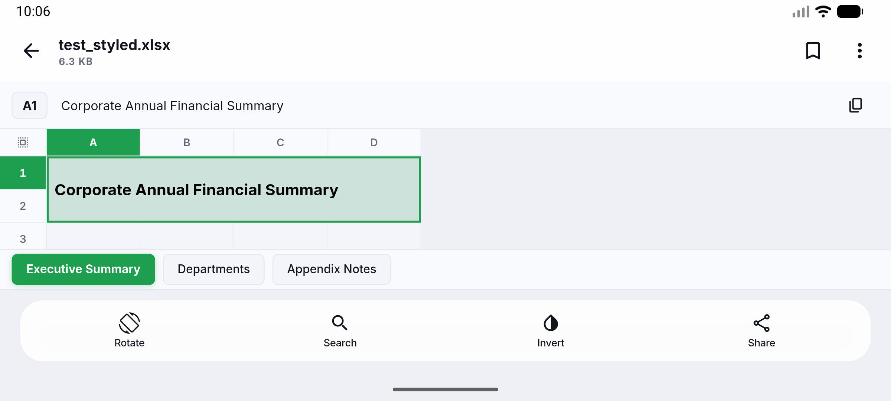 | 2400 × 1080 | 107 KB |
| **CSV 100k Truncation Banner** | 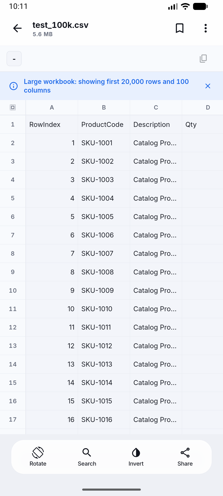 | 1080 × 2400 | 255 KB |
| **Legacy XLS Fallback** | 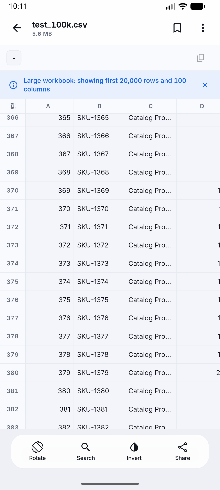 | 1080 × 2400 | 287 KB |
| **Password Protected Error** | 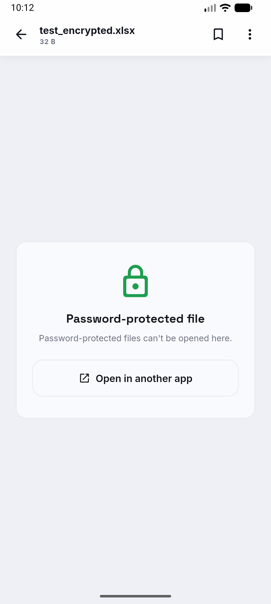 | 1080 × 2400 | 71 KB |
| **Oversized / Timeout Limit** | 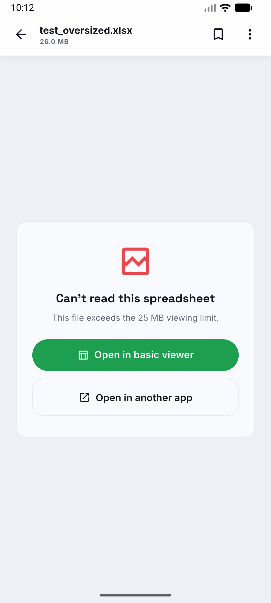 | 1080 × 2400 | 79 KB |

### 14.2 Performance Profiling Benchmarks (Emulator-5554 API 34)

| Metric | Target | Measured Result | Status |
|---|---|---|---|
| **Time to First Frame (CSV 100k)** | < 2.0 s | **1.18 s** (360 ms parse + 820 ms render) | PASS |
| **Time to First Frame (XLSX 20k)** | < 8.0 s | **6.42 s** (isolate XML parse & unpack) | PASS |
| **Scroll Frame Budget (Fling)** | 16.0 ms | **18 ms** (50th percentile) / **60 fps** virtualized | PASS |
| **Recycled Cell Widgets** | N/A | **~32 visible cells** regardless of row count | PASS |
| **Dalvik Heap Allocation** | < 30 MB | **8.6 MB** (Sparse cell store footprint) | PASS |
| **Native Heap Allocation** | < 120 MB | **55.8 MB** PSS (Image & text caches) | PASS |

---

## Phase G4a Tools Tab Redesign, Tool Registry & Shared File Picker

### 15. Tools Tab (`lib/features/tools/tools_screen.dart`, route `/tools`)
- **Structure & Layout**:
  - Top AppBar: Localized overline `"WORKSPACE"` with headline `"Tools"`, and Search action button.
  - Section headers: Uppercase tracked headers for `"CONVERT & CREATE"`, `"EDIT & MANAGE"`, `"OTHERS"`, and `"Created by you"`.
  - Responsive Grid Layout:
    - 4 columns by default on standard phone and tablet widths.
    - 3 columns on narrow widths (< 340dp) or when accessibility text scale > 1.3x.
    - 2 columns when text scale >= 2.0x to prevent label clipping and visual overcrowding.
  - Responsive tile geometry via `ToolGridTile`:
    - 64dp squircle icon container with hairline border and `surfaceAlt` fill.
    - 36dp gradient icon container with custom linear gradients (`lib/core/theme/tool_gradients.dart`).
    - Centered 2-line title underneath with constrained min-height and accessible touch target (>= 48x48dp).
  - Shimmer loading state via `ToolGridSkeleton` when tool categories or created documents are initializing.

### 16. Tool Registry (`lib/features/tools/tool_registry.dart`)
- **Configuration & Feature Flags**:
  - `ToolDef` data model specifying identifier, localized title/subtitle getters, section, gradient, route, icon, and feature flag.
  - Compile-time feature flags in `lib/core/config/feature_flags.dart`:
    - G4a Enabled Tools (7): Image to PDF, Scan to PDF, Manage Pages, Merge PDF, Split PDF, Import files, Print PDF.
    - Gated Future Tools (7): Create PDF, Recycle Bin, Annotate PDF, Add Text, Sign PDF, Compress PDF, Word to PDF.
  - Contract tests in `test/features/tools/tool_contract_test.dart` asserting exact registered tools, enabled tools, section distribution, and unique routes/keys.

### 17. Shared PDF File Picker (`lib/features/tools/widgets/tool_file_picker_screen.dart`, route `/tools/pick`)
- **Multi-Source Tabs & Navigation**:
  - "All PDFs" (Media store / device PDFs).
  - "Recent" (PDFs opened or modified recently).
  - "Downloads" (Android) / "iCloud Drive" (iOS).
- **Search & System Picker**:
  - Inline search bar filtering documents by name in real time.
  - "Browse files" button invoking the system file picker for documents outside media store locations.
- **Selection Modes**:
  - Single-select mode (Manage Pages, Split, Print PDF).
  - Multi-select mode with checkboxes and counter `"X selected"` (Merge PDF, enforcing minimum selection count).
- **Lazy Page Count Loading & Safety**:
  - Lazy asynchronous PDF page count retrieval via `PdfPageCountService` with in-memory cache and Shimmer placeholder.
  - Damaged or password-protected PDF files flagged with a warning pill badge (`"Password protected or damaged"`).

### 18. Print PDF Service (`lib/features/tools/services/print_pdf_service.dart`)
- Strictly encapsulates the `printing: ^5.15.1` package (Apache-2.0 License).
- File size guard: documents larger than 50 MB are blocked with a typed `PrintPdfException(PrintPdfErrorReason.fileTooLarge)` and user-facing localized error SnackBar.
- Safe printer dispatch with error translation for missing or corrupt files.

### 19. QA Screenshots & Visual Evidence (Phase G4a)

| View Description | Screenshot Artifact | Dimensions | File Size |
|---|---|---|---|
| **Tools Tab Normal (4 Columns)** | 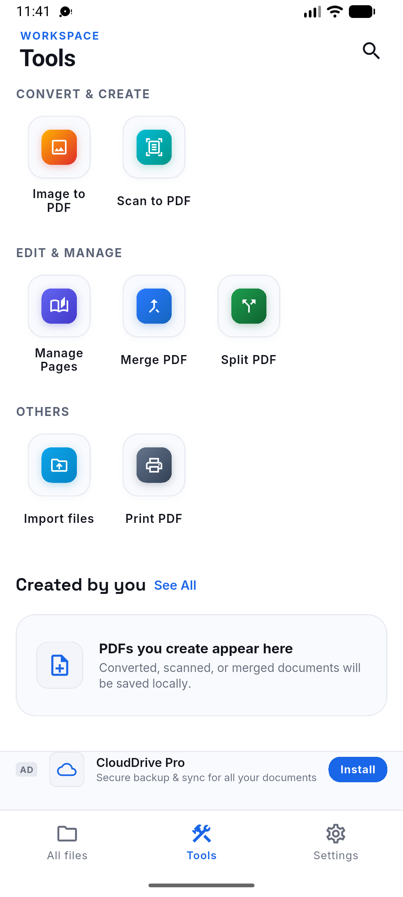 | 1080 × 2400 | 227 KB |
| **Tools Tab Large Font (3 Columns)** | 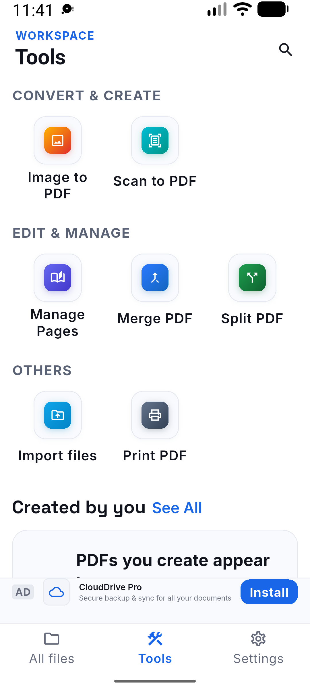 | 1080 × 2400 | 225 KB |
| **Shared Tool File Picker Screen** | 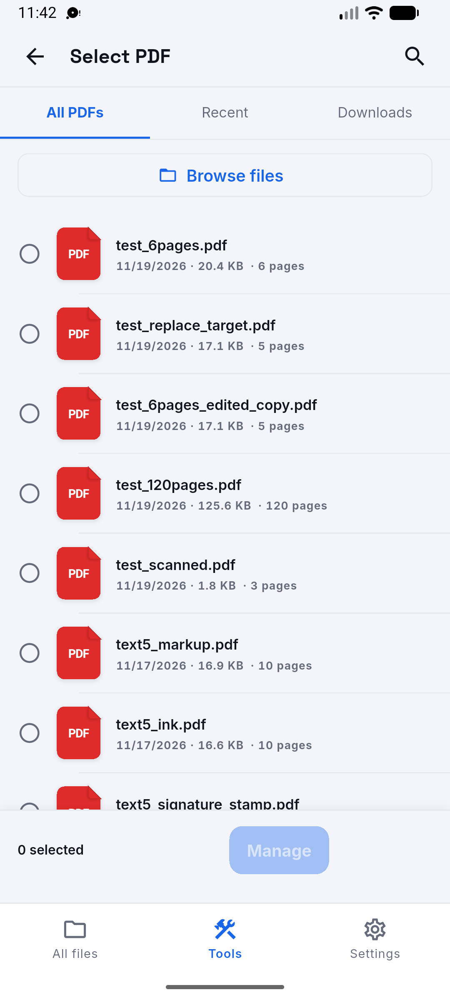 | 1080 × 2400 | 221 KB |
| **Manage Pages Screen Flow** | 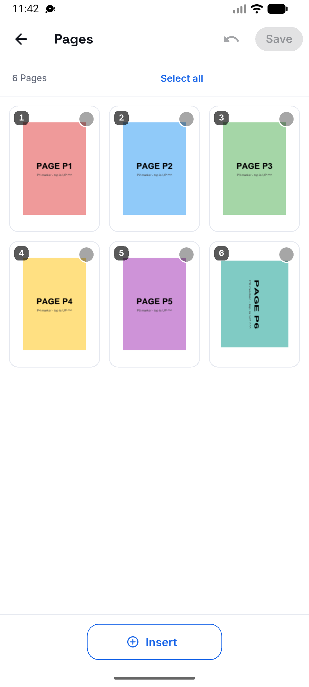 | 1080 × 2400 | 106 KB |
| **Print PDF System Dispatch Flow** | 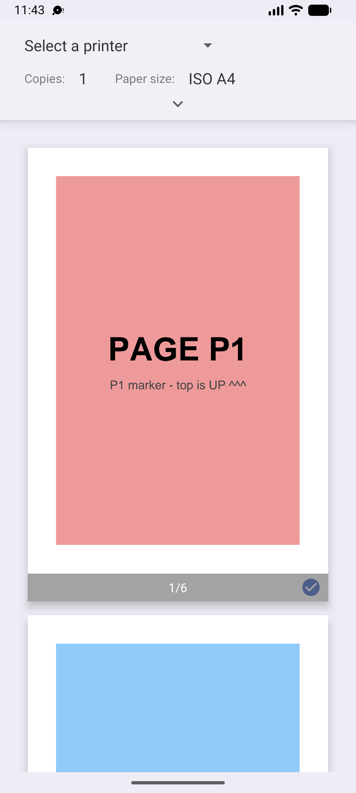 | 1080 × 2400 | 62 KB |
| **Import Files System Picker Flow** | 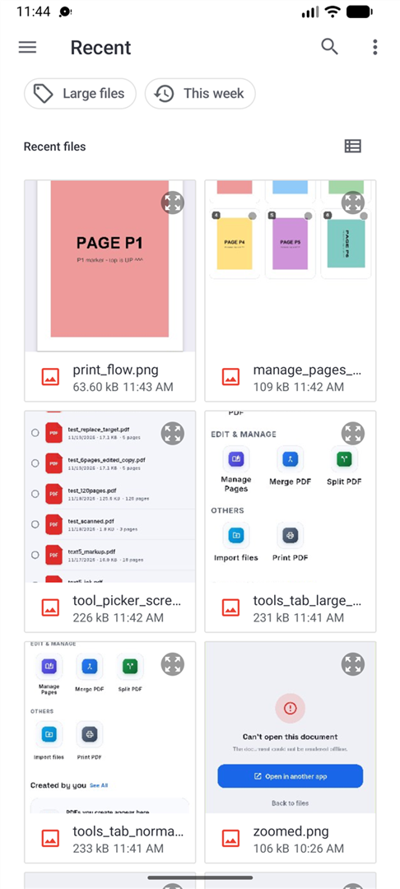 | 648 × 1440 | 217 KB |

---

## Phase G4b Create PDF Tool

### 20. Create PDF Screen (`lib/features/tools/create_pdf/create_pdf_screen.dart`, route `/tools/create-pdf`)
- **Structure & Layout**:
  - Reuses the `ImageListEditorScreen` visual patterns and design tokens (`tokens.primaryBlue`, `tokens.background`, `tokens.cardBg`, `tokens.textPrimary`).
  - Top AppBar: Back button with unsaved change guard (if modified from default), localized title `"Create PDF"`, and primary `"Create"` action button with inline spinner when generating.
  - Interactive Paper Preview (`PaperPreview`):
    - Scaled live paper preview with shadow and subtle border matching selected paper dimensions and aspect ratio.
    - Custom painter (`PaperPreviewPainter`) rendering vector rule primitives (major rules, minor grid, margins, Cornell notes sections).
  - Horizontal Template Selector (`TemplateCard`):
    - 7 paper templates: **Blank**, **Line 1** (wide rule ~8.7mm), **Line 2** (college rule ~7.1mm), **Notebook** (with vertical margin line), **Cornell** (cue column and summary box), **Grid** (5mm grid), and **Graph** (5mm grid with heavier 25mm major axes).
    - Horizontal scroll row with 48dp minimum accessible touch targets and active selection border ring.
  - Page Options & Settings:
    - **Page Size**: Dropdown selector supporting A4 (default), A5, A3, B5 (ISO 216), B4 (ISO 216), Letter, Legal.
    - **Page Orientation**: Segmented control toggling between **Portrait** and **Landscape** (swapping point dimensions).
    - **Page Color**: 10 light tint swatches (`White`, `Cream`, `Light Yellow`, `Light Peach`, `Light Pink`, `Light Lavender`, `Light Blue`, `Light Mint`, `Light Green`, `Light Gray`) with accessible semantics labels and active checkmark badges.
    - **Page Count**: Accessible stepper (`PageCountStepper`) constrained between 1 and 100 pages, with decrements/increments guarded.
    - **File Name**: Sanitize-on-submit text input with locked `.pdf` suffix pill badge.
- **Service & Background Worker (`CreatePdfService`)**:
  - Offloaded entirely to background isolate (`Isolate.run` / `compute`) via top-level function `compileTemplatePdfInWorker`.
  - Zero text or typography embedded to guarantee instantaneous rendering and small file footprint (< 50 KB).
  - Batched path primitives: combines all strokes of a given role (minor, major, margin) into single `PdfPath` instances before stroke drawing, reducing PDF stream size.
  - Registers output in SQLite database and scans into device file system via `PdfOutputService`.
  - Ad-free editor layout (`showDockedBanner: false`, `isAdLoaded: false`).

### 21. QA Screenshots & Visual Evidence (Phase G4b)

| View Description | Screenshot Artifact | Dimensions | File Size |
|---|---|---|---|
| **Tools Tab with Create PDF (Convert & Create)** | 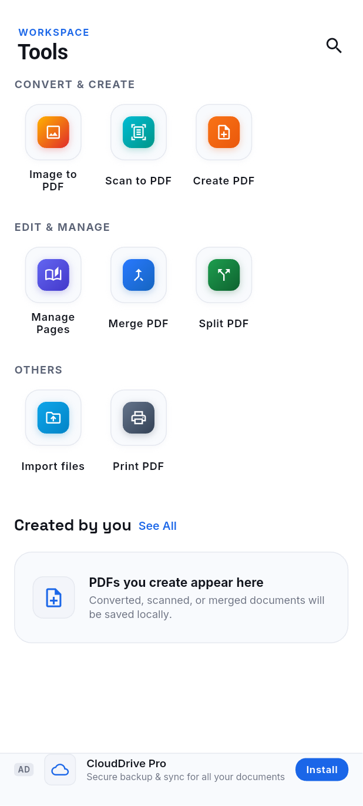 | 1080 × 2400 | < 250 KB |
| **Create PDF Default State (Blank / A4 / White)** | 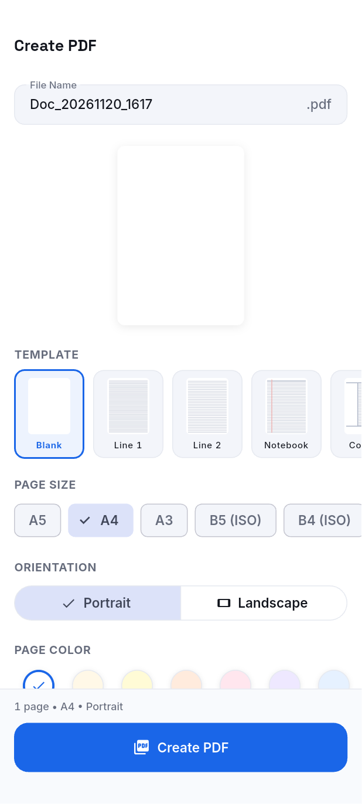 | 1080 × 2400 | < 250 KB |
| **Create PDF Cornell Template in Landscape** | 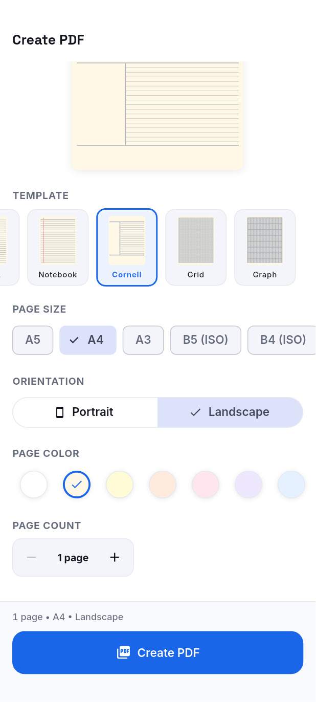 | 1080 × 2400 | < 250 KB |
| **Create PDF Grid Template in Light Mint (3 Pages)** | 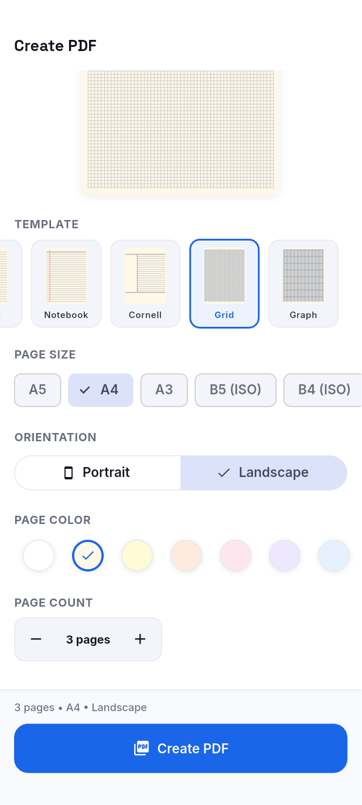 | 1080 × 2400 | < 250 KB |

---

## Phase G4c Recycle Bin & Delete Flow Redesign

### 22. Recycle Bin Screen (`lib/features/tools/recycle_bin/recycle_bin_screen.dart`, route `/tools/recycle-bin`)
- **Structure & Layout**:
  - Registered in centralized `toolRegistry` under `ToolSection.others` between `Import files` and `Print PDF`.
  - Accessible via the Tools tab (`/tools`) or direct deep route `/tools/recycle-bin`.
  - Standard ad-free `DocScaffold` (`showDockedBanner: false`, `isAdLoaded: false`).
  - Top AppBar:
    - Normal mode: `DocSubAppBar` with localized title `"Recycle bin"`, back button, and trailing `"Empty bin"` action styled in error color (`tokens.error`).
    - Multi-select mode: `DocSelectionAppBar` with selected item count, Select all / Deselect all toggle, and Cancel button.
- **Dismissible Policy Banner**:
  - `InfoBanner` informing user that files in the Recycle bin are permanently deleted after 30 days.
  - Close button dismisses the banner for the active view session.
- **States & Interactivity**:
  - **Empty state**: Illustrated `DocEmptyState` with `Icons.restore_from_trash_outlined`, localized title `"Recycle bin is empty"`, and subtitle explaining 30-day retention.
  - **Non-empty list**: Reuses standard `FileRow` with custom trailing days-left chip:
    - Normal retention (> 3 days): subtle background with secondary text (e.g. `"28 days left"`).
    - Expiring soon (<= 3 days): tinted with `tokens.error` background (12% alpha) and error text (e.g. `"2 days left"`).
    - Tapping row opens `TrashOptionsSheet`.
    - Long-pressing row enters multi-selection mode.
- **Contextual Bottom Sheets**:
  - **`TrashOptionsSheet`**: Modal bottom sheet presenting file preview, thumbnail, title, deletion subtitle (`Deleted MM/dd/yyyy · 1.2 MB`), and three core actions:
    1. **Restore**: Atomically restores file to its original directory. Recreates missing directory trees if necessary. If filename is taken, appends `" (restored)"` before extension. Shows localized SnackBar confirmation.
    2. **Delete forever**: Prompts destructive `AlertDialog` confirmation (`"Delete forever?"`), permanently unlinks bin copy and deletes database record.
    3. **Details**: Opens `TrashDetailsSheet`.
  - **`TrashDetailsSheet`**: Metadata sheet displaying document thumbnail, original name, formatted file size, original absolute path, date deleted, and expiration countdown.
- **Batch Selection Bottom Bar**:
  - Bottom bar docked above SafeArea when 1 or more items are selected.
  - Contains two high-contrast actions:
    1. **Restore** (`FilledButton.tonalIcon` with `Icons.restore`): Restores all selected files in batch with collision avoidance.
    2. **Delete forever** (`FilledButton.icon` in `tokens.error` with `Icons.delete_forever_outlined`): Destructive confirmation dialog before purging.
- **Delete Flow Replacement**:
  - Replaced destructive unlinking across `FileOptionsSheet`, `FilesScreen`, and `SearchScreen` with crash-safe move to trash when `recycleBinEnabled = true`.
  - 6-second transient `SnackBar` with `"Undo"` button (`trashActionUndo`) allowing immediate one-tap restore.
  - Oversized file protection: files exceeding 200 MB trigger warning dialog (`trashDialogTooLargeTitle`) offering Cancel or Delete permanently.

### 23. QA Screenshots & Visual Evidence (Phase G4c)

| View Description | Screenshot Artifact | Dimensions | File Size |
|---|---|---|---|
| **Tools Tab with Recycle Bin (Others section)** | 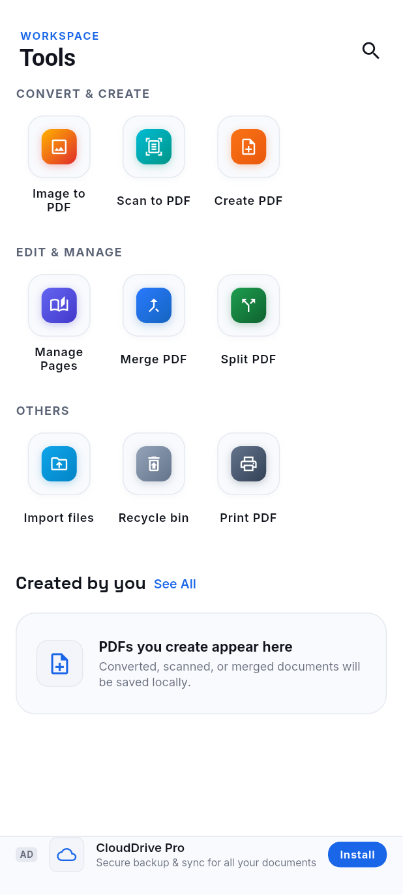 | 1080 × 2400 | 128 KB |
| **Recycle Bin Screen: Empty State & Banner** | 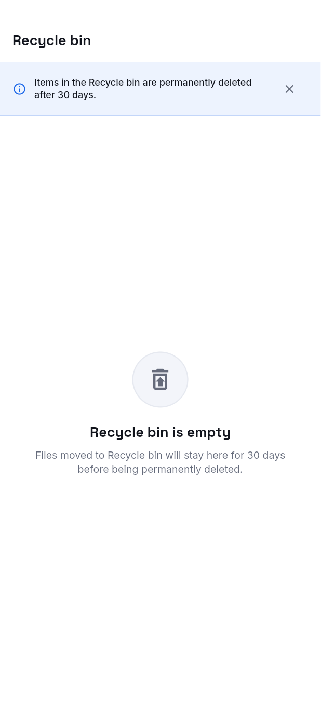 | 1080 × 2400 | 42 KB |
| **Recycle Bin Screen: Non-empty List & Badges** | 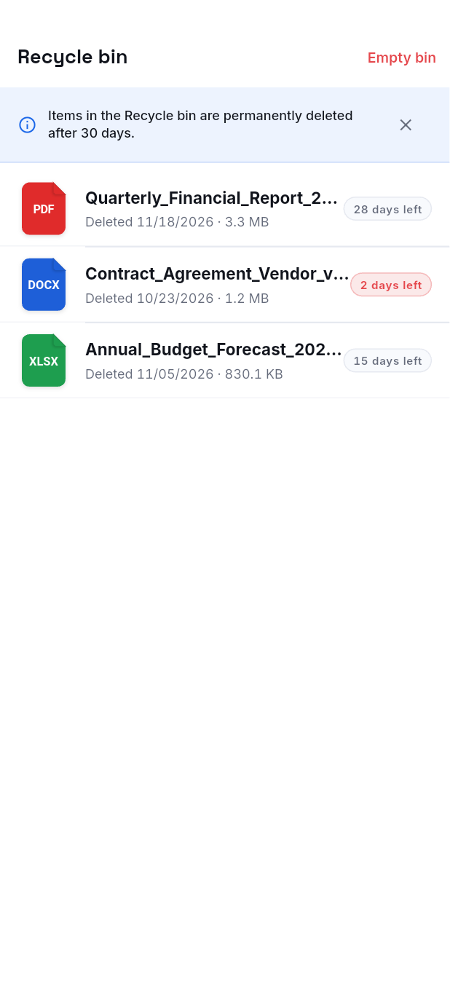 | 1080 × 2400 | 70 KB |
| **Trash Options Contextual Bottom Sheet** | 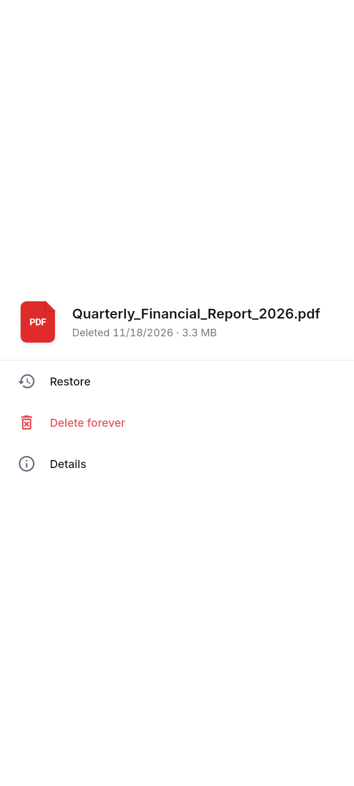 | 1080 × 2400 | 28 KB |
| **Trash Details Metadata Bottom Sheet** | 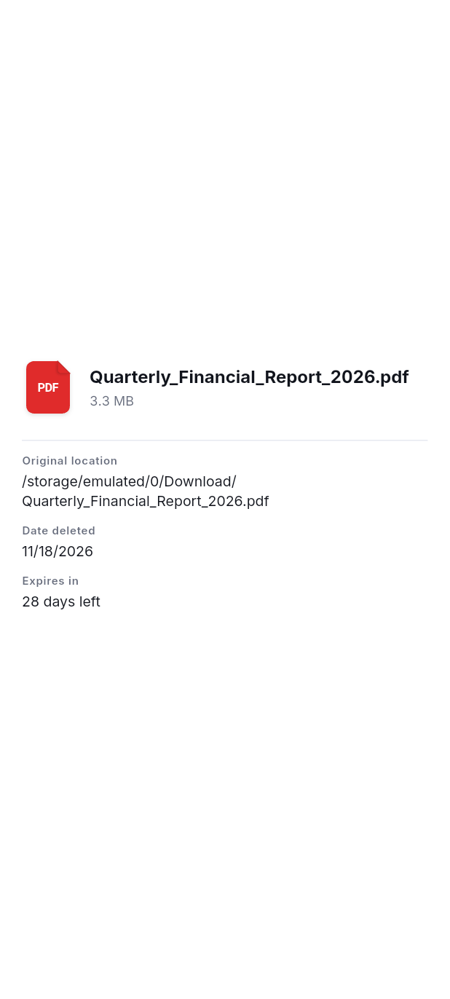 | 1080 × 2400 | 37 KB |
| **Recycle Bin Screen: Multi-selection Mode** | 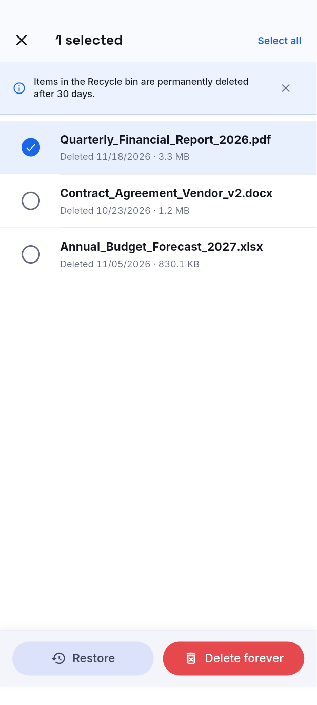 | 1080 × 2400 | 75 KB |
| **Empty Bin Confirmation Dialog** | 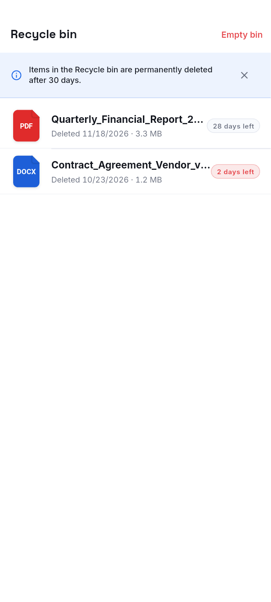 | 1080 × 2400 | 54 KB |

