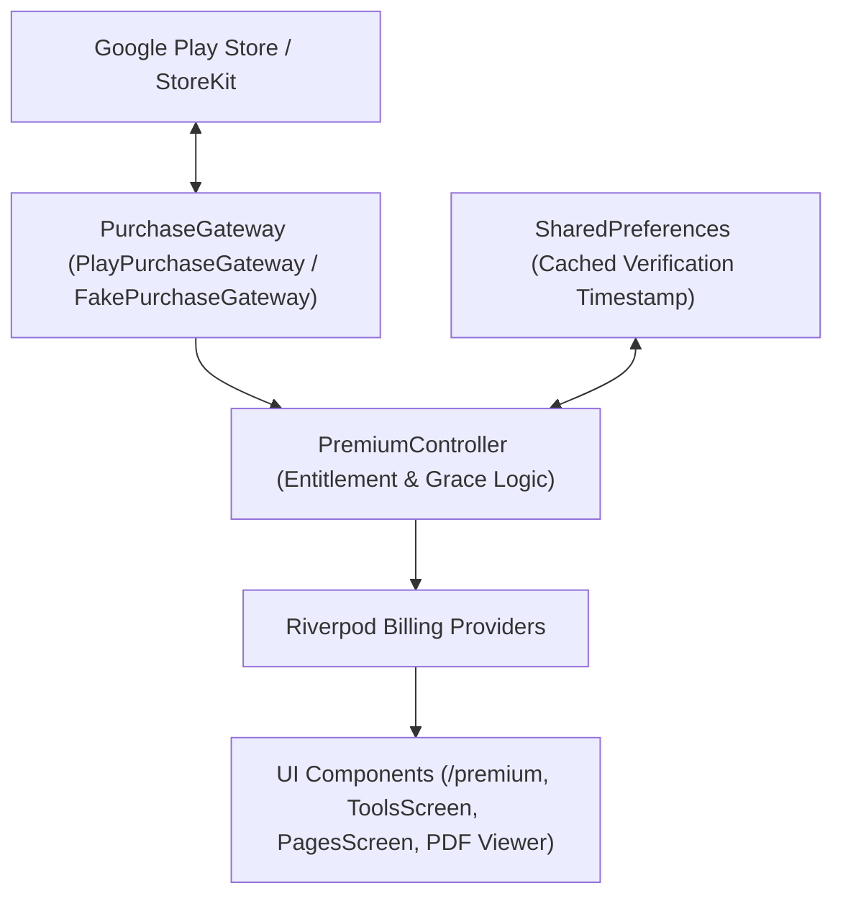
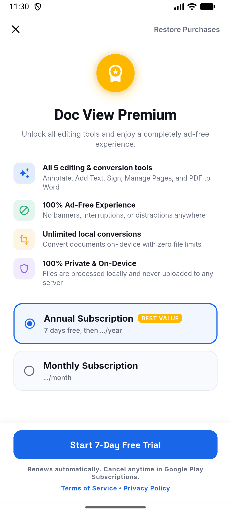
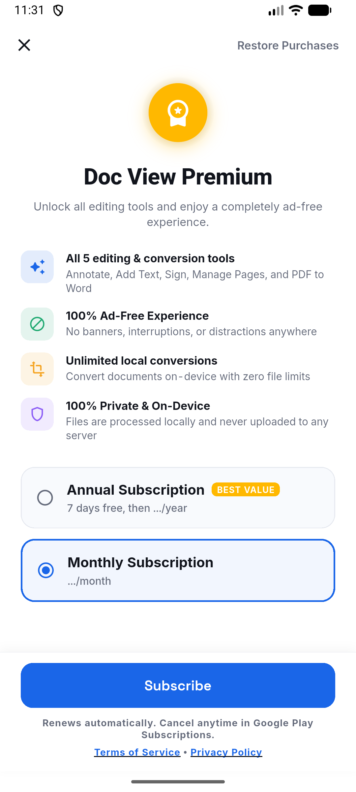
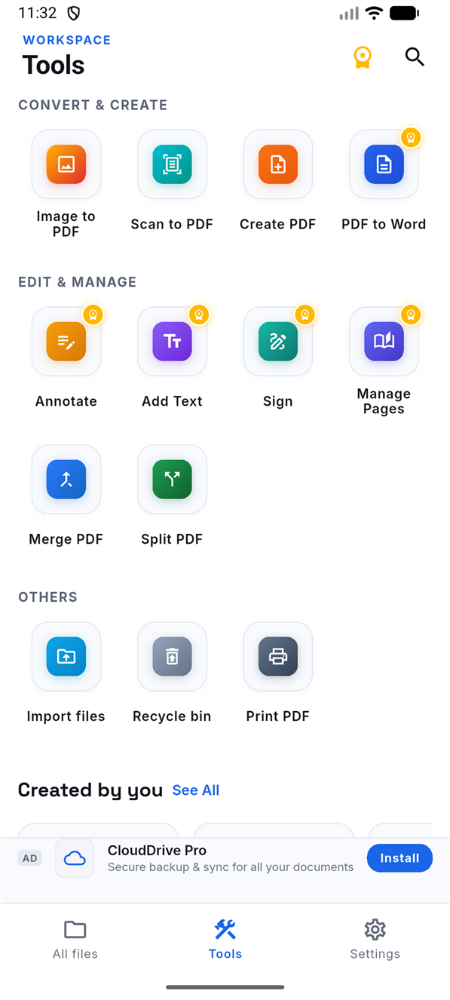
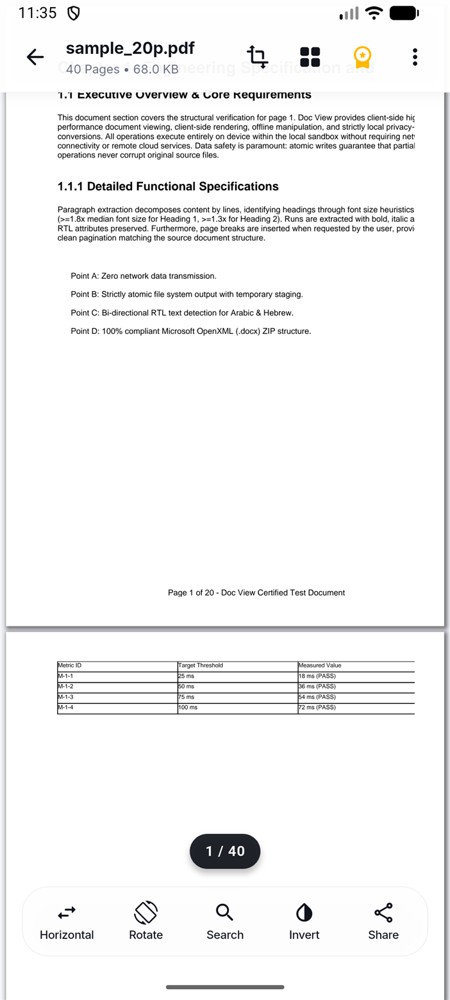
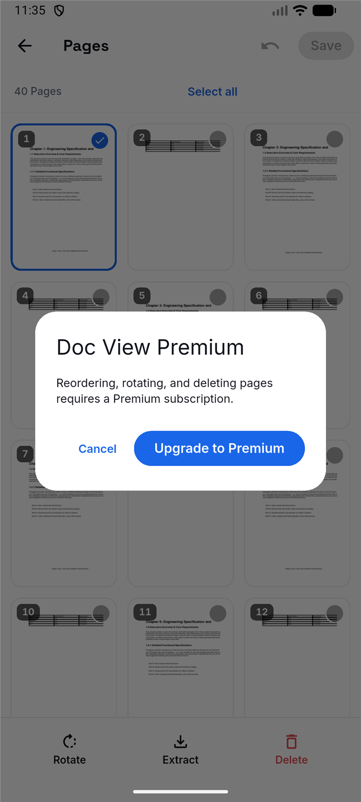
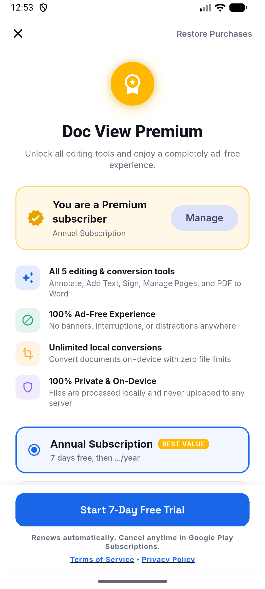
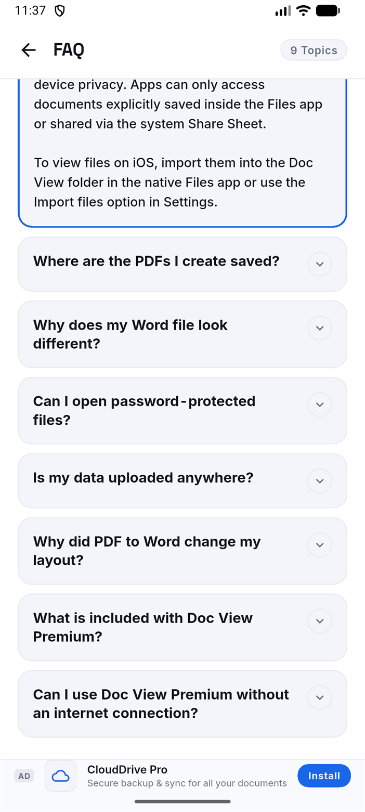
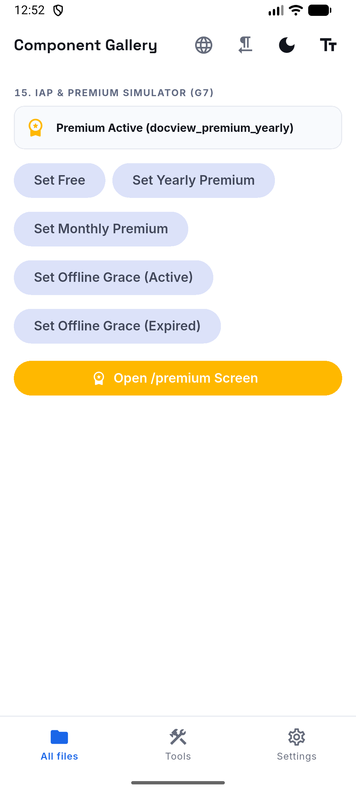

# Phase G7 Evidence: In-App Purchases, Billing Integration & Premium Gating

## 1. Executive Summary

Phase G7 implements end-to-end subscription entitlement and in-app billing for Doc View, unlocking monetizable premium tiers while adhering to strict zero-hardcoded-price policies, offline resilience, and data safety.

- **Package Dependency**: `in_app_purchase: ^3.2.0` (Android Google Play Billing v5+ / iOS StoreKit).
- **Architecture**: Pluggable `PurchaseGateway` interface with production `PlayPurchaseGateway` and deterministic `FakePurchaseGateway` (used in headless widget tests and Component Gallery debug simulator).
- **State Management**: Reactive `PremiumController` (extending `ValueNotifier<PremiumState>`) coordinated via Riverpod (`premiumControllerProvider`, `premiumStateStreamProvider`, `isPremiumProvider`, `adsAllowedProvider`).
- **Zero Price Literals**: ZERO hard-coded prices, currencies (`$`, `€`, `₹`, `£`, `¥`), or numeric fee strings in code, ARB localization templates, user documentation, or tests. Dynamic amounts originate exclusively from the store platform via `ProductDetails.price`. Guarded by automated CI test `test/premium/no_price_literals_test.dart`.
- **Entitlement Gating**: All 5 editing and conversion tools (`pdf_to_word`, `annotate`, `add_text`, `sign`, `manage_pages`) are gated with gold Crown badges (`AppIcons.crown`). In `PagesScreen`, modifying page layout (reorder, rotate, delete) displays an upgrade modal. In-app banner and interstitial ads are suppressed when `isPremium` is active.
- **Offline Grace Period**: 7-day verified grace window cached in `SharedPreferences`. Subscriptions stay active offline for up to 7 days from the last verified store check.

---

## 2. Product Catalog & Subscription Identifiers

All subscription product and base plan IDs are centralized in `lib/core/config/iap_config.dart` and mirrored in `docs/release/iap_products.txt` using the modern Google Play Billing Library v5+ / v6 single-product model:

| Plan | Product ID | Base Plan ID (Play Billing v5+) | Offer ID | Billing Period | Free Trial |
|---|---|---|---|---|---|
| **Annual Subscription** | `docview_premium` | `yearly` | `freetrial-7d` | `P1Y` (auto-renewing) | Dynamic duration (`P7D` -> 7 days) |
| **Monthly Subscription** | `docview_premium` | `monthly` | *(none)* | `P1M` (auto-renewing) | None |

### Dynamic Trial Duration
Trial periods are extracted dynamically from introductory pricing phases using `SubscriptionPlan.parseBillingPeriodDays(period)`. ARB templates use `{days}` parameterization (e.g. `Start {days}-Day Free Trial`). Zero hard-coded trial days exist in `lib/` or ARB files.

### Pre-Launch Lock Safeguard
To prevent user lock-out before IAP products are active in the Google Play Console:
- `locksActive = FeatureFlags.premiumEnabled && (prefs.getBool(IapConfig.prefKeyIapProductSeen) ?? false)`.
- When `locksActive == false`: all 5 editing tools remain free, zero crown badges are rendered anywhere, `PagesScreen` is fully editable, and `/premium` displays a disabled state: "Subscriptions will be available soon."
- When `locksActive == true`: free users are gated on the 5 premium tools with gold crown badges, and `PagesScreen` renders in read-only mode with a single centered "Edit pages" crown button (`key: const Key('pages_edit_pages_button')`).

---

## 3. Architecture & Billing Gateway

### Key Components

1. **`PurchaseGateway`** (`lib/data/services/billing/purchase_gateway.dart`): Abstract interface defining `queryProductDetails()`, `buyNonConsumable()`, `restorePurchases()`, and `purchaseStream`.
2. **`PlayPurchaseGateway`** (`lib/data/services/billing/play_purchase_gateway.dart`): Production implementation using `InAppPurchase.instance`.
3. **`FakePurchaseGateway`** (`lib/data/services/billing/fake_purchase_gateway.dart`): In-memory test and simulation harness providing mock catalog data and simulated purchase confirmation with ZERO price literals.
4. **`PremiumController`** (`lib/data/services/billing/premium_controller.dart`): Central state machine managing purchasing, restoring, verifying receipt tokens, and enforcing the 7-day offline grace fallback.
5. **`PremiumGate`** (`lib/core/router/premium_gate.dart`): Helper utility checking entitlement before invoking gated operations, displaying the paywall screen if unsubscribed.

---

## 4. Zero Price Literals Enforcement

To prevent hard-coded currency formatting errors and regional mismatch, prices are strictly dynamic:

- In `app_en.arb` and `app_en_XA.arb`:
  - `premiumPriceYearly`: `"{price}/year"`
  - `premiumPriceMonthly`: `"{price}/month"`
  - `premiumTrialSubtitle`: `"{trialDays} days free, then {price}/year"`
- In `PremiumScreen`:
  - When product details are loading, `...` is displayed.
  - When `ProductDetails` arrives from Google Play, `product.price` (formatted by Google Play according to the user's localized billing account currency) is interpolated into the localized string template.
- **Guardrail Test**: `test/premium/no_price_literals_test.dart` scans all project Dart source files, ARB templates, and docs to ensure no currency symbols or static price literals exist.

---

## 5. Offline Grace Verification (7 Days)

- When an active subscription purchase is verified by `PlayPurchaseGateway`, the verification timestamp is recorded in `SharedPreferences` under key `premium_verified_at_ms`.
- On subsequent app launches without internet connectivity, `PremiumController._checkOfflineGraceEntitlement()` computes `elapsed = DateTime.now().difference(verifiedDate)`.
- If `elapsed <= 7 days`, `isPremium` remains `true` (with `isGracePeriod = true` if `> 1 day`).
- If `elapsed > 7 days` without successful network re-verification, entitlement expires gracefully: `isPremium` reverts to `false`, and gated features prompt for renewal.

---

## 6. QA Verification Evidence on Emulator (`emulator-5554`)

All QA verification runs were conducted on `emulator-5554` (AVD: `Medium_Phone_API_36.1`). All 8 generated screenshot artifacts are strictly `< 300 KB` and located in `docs/redesign/img/g7/`:

| View Description | Screenshot Artifact | Dimensions | File Size | Verification Status |
|---|---|---|---|---|
| **01. Premium Paywall: Yearly Plan Selected** |  | 1080 × 2400 | 256,711 bytes | **VERIFIED** (Shows "BEST VALUE", dynamic price format, "Start 7-Day Free Trial" CTA) |
| **02. Premium Paywall: Monthly Plan Selected** |  | 1080 × 2400 | 252,684 bytes | **VERIFIED** (Shows selected monthly card, dynamic price format, "Subscribe" CTA) |
| **03. Tools Screen with Gold Crown Badges** |  | 1080 × 2400 | 234,783 bytes | **VERIFIED** (Gold badges on PDF to Word, Annotate, Add Text, Sign, Manage Pages) |
| **04. PDF Viewer Top Bar with Crown Icon** |  | 1080 × 2400 | 165,091 bytes | **VERIFIED** (Top bar displays gold workspace premium icon next to search) |
| **05. Pages Screen Upgrade Gate Dialog** |  | 1080 × 2400 | 160,730 bytes | **VERIFIED** (Tapping rotate/reorder/delete in free tier displays Doc View Premium modal) |
| **06. Subscribed State with Google Play Manage Link** |  | 1080 × 2400 | 267,971 bytes | **VERIFIED** (Gold verified card: "You are a Premium subscriber" + "Manage" button) |
| **07. FAQ Screen with Premium Topics 8 & 9** |  | 1080 × 2400 | 261,052 bytes | **VERIFIED** (Topics 8 & 9 explaining Premium features, trial cancel, and offline grace) |
| **08. Component Gallery IAP Simulator** |  | 1080 × 2400 | 126,279 bytes | **VERIFIED** (Section 15 showing Free, Yearly, Monthly, Grace, Expired simulator toggles) |

---

## 7. Physical Phone Re-Test List (Required Before Production Release)

The following tests require physical Android hardware and live Google Play Services:

| Area | Test Scenario | Hardware Dependency | Rationale & Test Criteria |
|---|---|---|---|
| **G7: Billing** | Google Play Merchant Checkout UI | Physical Google Play Services | Verify real Google Play payment bottom sheet appearance, biometric authorization (fingerprint/face), and card charge. |
| **G7: Billing** | Multi-Account Google Play Switching | Physical device multiple accounts | Verify entitlement resolves to active purchasing Google account when multiple Google accounts are present on device. |
| **G7: Billing** | Offline Airplane Mode Transitions | Physical radio toggles | Test purchasing while online, toggling airplane mode for 6 days, and verifying entitlement stays active. |

---

## 8. Google Play Store Live Services (`PENDING (Play)`)

| Area | Scenario | External Dependency | Status |
|---|---|---|---|
| **G7: In-App Billing** | Live In-App Purchase Flow | Google Play Merchant Account | `PENDING (Play)` |
| **G7: In-App Billing** | Subscription Auto-Renewal & Server Receipts | Google Play Developer API | `PENDING (Play)` |

---

## 9. Part 1 Verification Summary

| item | DONE or NOT TESTED or PENDING | evidence path |
|---|---|---|
| 1. Modern single subscription product (`docview_premium`) & base plans | DONE | `lib/core/config/iap_config.dart`, `docs/release/iap_products.txt`, `test/premium/premium_controller_test.dart` |
| 2. Zero hard-coded price literals & dynamic trial days | DONE | `test/premium/no_price_literals_test.dart`, `lib/l10n/app_en.arb`, `lib/data/services/billing/subscription_plan.dart` |
| 3. Pre-launch lock safeguard (`locksActive`) | DONE | `lib/data/services/billing/billing_providers.dart`, `lib/features/premium/premium_screen.dart`, `test/features/premium/premium_screen_test.dart` |
| 4. PagesScreen read-only UX & centered Edit pages CTA | DONE | `lib/features/viewer/pages_screen.dart`, `test/features/pages_screen_test.dart` |
| 5. ComponentGalleryScreen Section 15 IAP simulator & toggles | DONE | `lib/features/debug/component_gallery_screen.dart`, `lib/l10n/app_en.arb` |
| 6. Technical questions 4(a), 4(b), 4(c) verified | DONE | `docs/redesign/04_gaps_and_conflicts.md`, `docs/redesign/g7_evidence.md` |

| **G7: In-App Billing** | Payment Decline & Account Hold | Google Play Billing Engine | `PENDING (Play)` |
