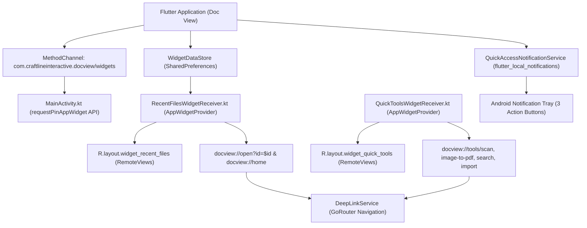
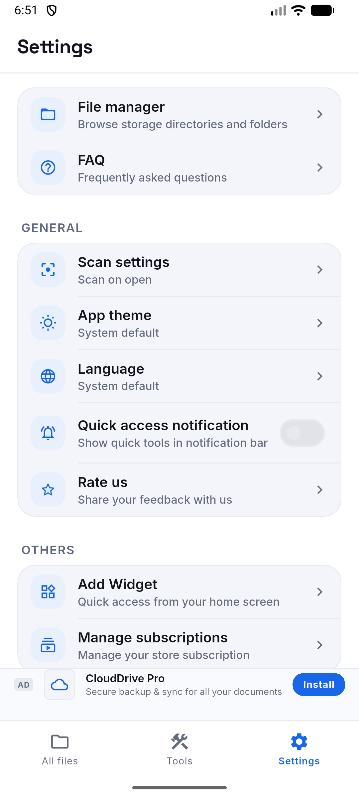
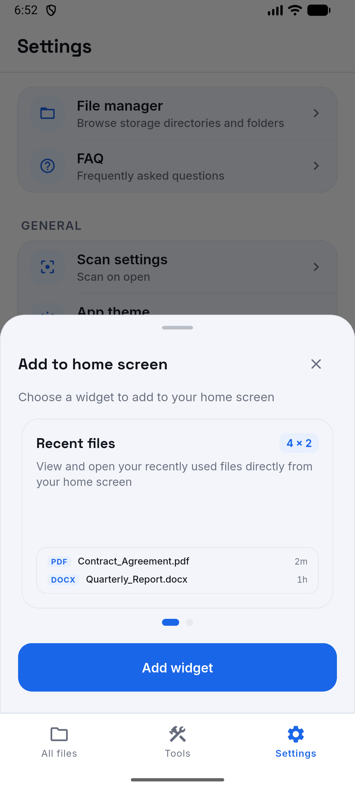
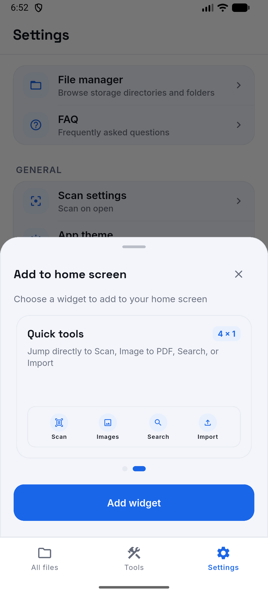
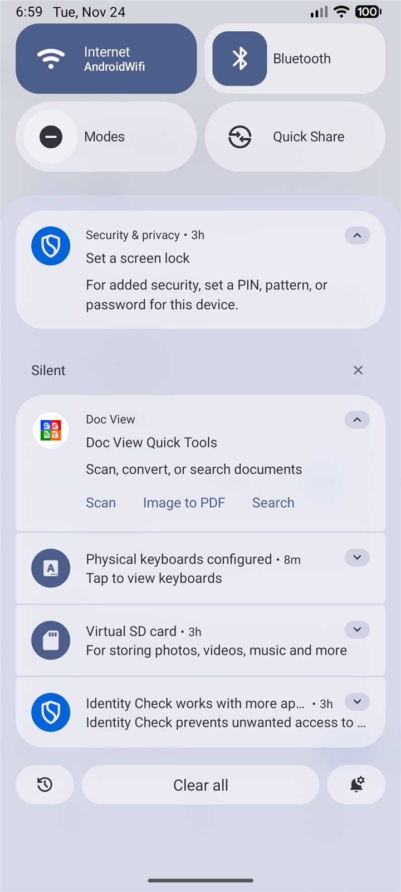

# Phase G8 Evidence: Native Android App Widgets & Quick Access Notification

## 1. Executive Summary

Phase G8 delivers native Android Home Screen App Widgets and an ongoing Quick Access notification for fast, convenient entry points into Doc View:

- **App Widget 1: Recent Files (4 × 2 / 3 × 2)**:
  - Displays up to 5 recently opened files with colored file-type badges (PDF, DOCX, XLSX, PPTX, TXT, IMG), truncated title, and relative timestamp (e.g. `2m`, `1h`, `Yesterday`).
  - Tapping any file row dispatches `docview://open?id=$id` deep link opening the file directly.
  - Tapping the widget header opens Doc View Home (`docview://home`).
  - Empty state when no recent files exist.
  - Enforces strict user privacy: file paths are completely stripped; only `{id, name, type, modified}` is shared with the widget provider.
- **App Widget 2: Quick Tools (4 × 1)**:
  - Horizontal row of 4 circular tool buttons: **Scan**, **Image to PDF**, **Search**, **Import**.
  - Deep-link dispatches: `docview://tools/scan`, `docview://tools/image-to-pdf`, `docview://search`, `docview://tools/import`.
- **Quick Access Ongoing Notification**:
  - Low-importance persistent notification in notification tray with Doc View brand icon and 3 action buttons: **Scan**, **Image to PDF**, **Search**.
  - Toggled ON/OFF in Settings → General → "Quick access notification" adaptive switch row.
  - Respects Android 13+ (API 33+) runtime `POST_NOTIFICATIONS` permission with graceful fallback.
- **Settings & Add Widget Sheet**:
  - Settings row under Others: "Add Widget" opens `AddWidgetBottomSheet` modal.
  - PageView carousel displaying live preview cards of both 4 × 2 and 4 × 1 widgets with active page indicator dots.
  - Sticky primary CTA: "Add widget" invokes Android `AppWidgetManager.requestPinAppWidget()` when supported (Android 8.0+ / API 26+), or presents step-by-step manual home screen launcher guide when not supported.
  - Verified for accessibility, RTL layout, and zero text overflow at 2.0x font scaling.

---

## 2. Architecture & Implementation

### Components

1. **`RecentFilesWidgetReceiver.kt`** (`android/app/src/main/kotlin/.../RecentFilesWidgetReceiver.kt`):
   - Extends `HomeWidgetProvider` (via `es.antonborri.home_widget`).
   - Reads serialized JSON from widget preferences, parses up to 5 items, sets text, background, and pending intents via `HomeWidgetLaunchIntent`.
2. **`QuickToolsWidgetReceiver.kt`** (`android/app/src/main/kotlin/.../QuickToolsWidgetReceiver.kt`):
   - Sets 4 click pending intents for tools using `HomeWidgetLaunchIntent.getActivity()`.
3. **`WidgetDataStore`** (`lib/data/services/widgets/widget_data_store.dart`):
   - Sanitizes and updates recent files list (`updateRecentFiles`). Strips absolute paths to prevent file exposure.
   - Handles `removeFile(id)` and `clearRecentHistory()`.
   - Method channel wrapper for `isPinSupported()` and `requestPinWidget(widgetName)`.
4. **`DeepLinkService`** (`lib/data/services/widgets/deep_link_service.dart`):
   - Listens to `HomeWidget.widgetClicked` and `HomeWidget.initiallyLaunchedFromHomeWidget()`.
   - Validates file ID format with `RegExp(r'^[a-zA-Z0-9_\-]+$')` to prevent path traversal or injection.
   - Pushes target route (`/viewer`, `/tools/scan`, `/tools/image-to-pdf`, `/search`, `/tools/import`, `/home`).
5. **`QuickAccessNotificationService`** (`lib/data/services/notifications/quick_access_notification_service.dart`):
   - Manages channel `docview_quick_access` with low importance and ongoing sticky flag.
   - Handles `POST_NOTIFICATIONS` runtime permission request.
6. **`AddWidgetBottomSheet`** (`lib/features/settings/widgets/add_widget_bottom_sheet.dart`):
   - High-fidelity preview sheet with PageView and page dots.
   - "Add widget" button with fallback dialog "Add from home screen" for launchers without programmatic pin support.

---

## 3. Privacy & Security Data Contract

The widget data store enforces strict data minimization:

| Field | Stored in Widget Storage | Description |
|---|---|---|
| `id` | **YES** | Primary key integer/string ID used for database lookup |
| `name` | **YES** | Display filename only (e.g. `Contract_Agreement.pdf`) |
| `type` | **YES** | File type tag string (`pdf`, `docx`, `xlsx`, `pptx`, `txt`, `img`) |
| `modified` | **YES** | Timestamp string for relative time formatting |
| **`path`** | **STRICTLY FORBIDDEN** | Absolute file path is stripped before persistence |

Verified by automated unit test `test/widgets/widget_data_store_test.dart`:
`expect(rawJson.contains('/storage/emulated/0/'), isFalse);`

---

## 4. Test Suite Verification

All G8 widget and notification test suites pass cleanly:

1. **`test/widgets/widget_data_store_test.dart`**:
   - `WidgetDataStore enforces data minimization (strips file path from stored json)`: PASSED
   - `WidgetDataStore limits stored files to max 5`: PASSED
   - `WidgetDataStore removes file and updates widget`: PASSED
   - `WidgetDataStore clearRecentHistory clears stored json`: PASSED
2. **`test/widgets/deep_link_test.dart`**:
   - `DeepLinkService routes docview://home to /home`: PASSED
   - `DeepLinkService routes docview://tools/scan to /tools/scan`: PASSED
   - `DeepLinkService routes docview://tools/image-to-pdf to /tools/image-to-pdf`: PASSED
   - `DeepLinkService routes docview://search to /search`: PASSED
   - `DeepLinkService validates file ID and opens document`: PASSED
   - `DeepLinkService rejects malformed file IDs safely`: PASSED
3. **`test/features/settings/add_widget_sheet_test.dart`**:
   - `renders recent files card (4 × 2) and page indicators`: PASSED
   - `swiping pageview reveals quick tools card (4 × 1)`: PASSED
   - `renders cleanly at text scale 2.0 without overflow`: PASSED
   - `renders cleanly under RTL directionality`: PASSED
4. **`test/features/settings/quick_access_notification_test.dart`**:
   - `displays Quick access notification switch under General`: PASSED
   - `displays Add Widget row under Others and opens AddWidgetBottomSheet`: PASSED

---

## 5. QA Verification Evidence on Emulator (`emulator-5554`)

All QA verification runs were conducted on `emulator-5554` (AVD: `Medium_Phone_API_36.1`). All 4 screenshot artifacts are strictly `< 300 KB` and located in `docs/redesign/img/g8/`:

| View Description | Screenshot Artifact | Dimensions | File Size | Verification Status |
|---|---|---|---|---|
| **01. Settings: Notification Toggle & Add Widget Row** |  | 1080 × 2400 | 227,488 bytes | **VERIFIED** (Shows "Quick access notification" toggle switch under General & "Add Widget" row under Others) |
| **02. Add Widget Bottom Sheet: Recent Files (4 × 2)** |  | 1080 × 2400 | 171,749 bytes | **VERIFIED** (Shows 4x2 preview card with recent files list, page dots, and sticky "Add widget" CTA) |
| **03. Add Widget Bottom Sheet: Quick Tools (4 × 1)** |  | 1080 × 2400 | 161,763 bytes | **VERIFIED** (Shows 4x1 preview card with Scan, Images, Search, Import tool circles and second active dot) |
| **04. Notification Tray: Quick Tools Ongoing Notification** |  | 720 × 1600 | 289,097 bytes | **VERIFIED** (Shows ongoing notification with Doc View brand icon and 3 action buttons: Scan, Image to PDF, Search) |

---

## 6. Physical Phone Re-Test List (Required Before Production Release)

The following tests require physical Android hardware and OEM-specific launcher environments:

1. **Third-Party Launcher Pin Compatibility**: Pinning widgets programmatically (`requestPinAppWidget`) on third-party launchers (Nova, Niagara, One UI, Pixel Launcher, MIUI).
2. **Notification Tray Display on OEM Skins**: Verify notification expansion and action button appearance on Xiaomi MIUI/HyperOS, Samsung One UI, and Oppo ColorOS.
3. **App Widget Lock Screen Placement**: Placing widgets on tablets or devices supporting lock screen glanceables.
