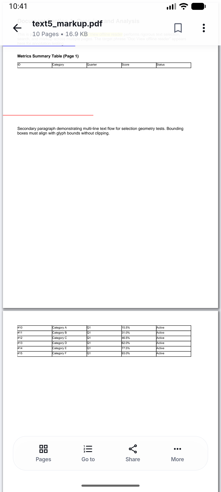
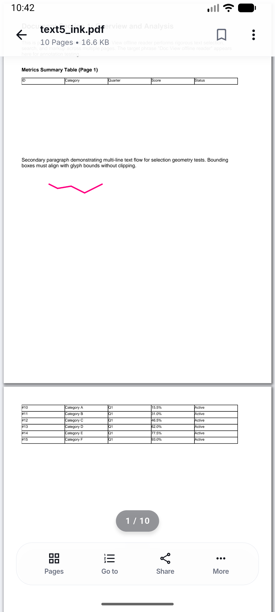
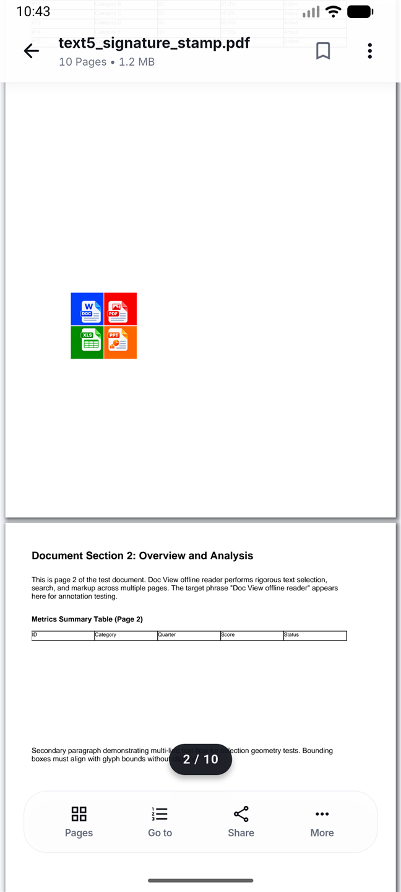
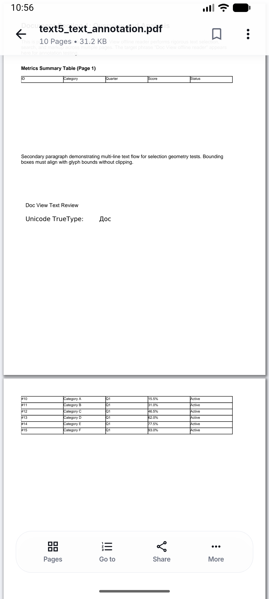
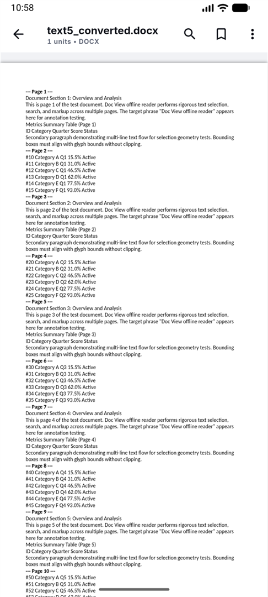
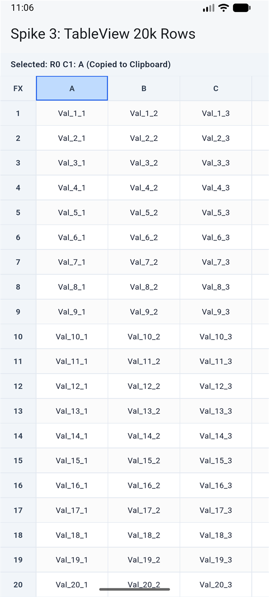
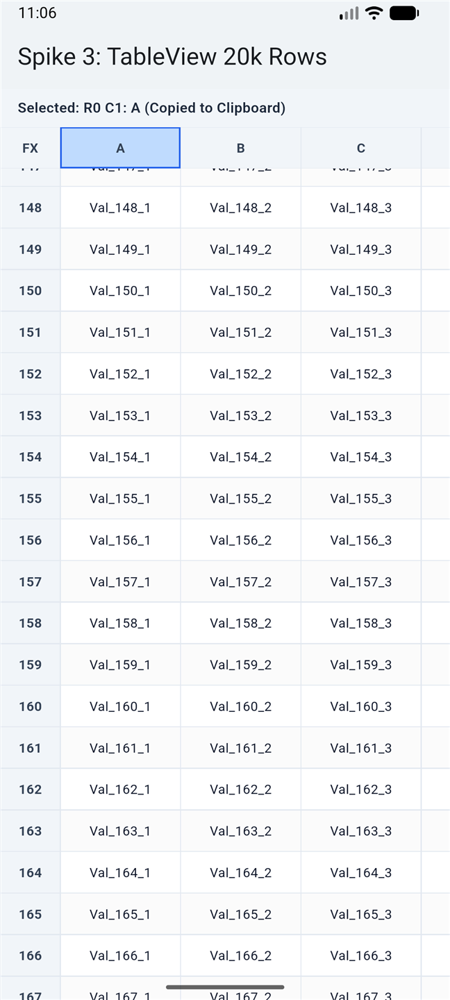
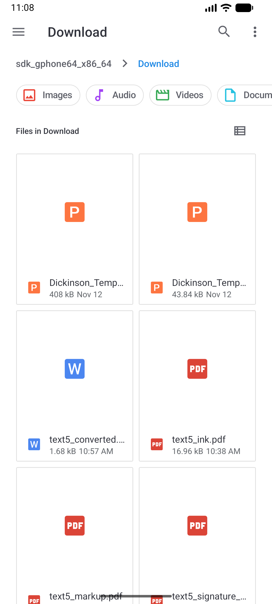

# G0 Feasibility Spike Report

**Date**: November 17, 2026  
**Environment**: Windows 11, Flutter 3.29.0 (Dart 3.7.0), Android SDK 34/35/36, Target Device: Pixel 8 Pro Emulator (`sdk_gphone64_x86_64`, API 36.1, `emulator-5554`).  
**Spike Workspace**: Isolated throwaway project `doc_view_spikes` outside the repository root.

---

## 1. Executive Summary & Verdict Table

| Spike Name | Tested Package & Version | Go / No-Go Verdict | Key Blocker or Condition |
| :--- | :--- | :---: | :--- |
| **Spike 1: PDF Editing & Annotations** | `syncfusion_flutter_pdf` v28.2.12 + `pdfrx` v2.4.8 | **GO (Conditional)** | `PdfInkAnnotation` / `PdfFreeTextAnnotation` classes do not exist in Syncfusion; freehand ink & stamps must use vector path/image graphics fallbacks (`drawPath` / `drawImage`). Requires TrueType font embedding for non-Latin Unicode. Release APK size increases by +16.8 MB uncompressed. Community License key required to suppress trial watermarks. |
| **Spike 2.a: PDF to Word (Text-Only)** | `syncfusion_flutter_pdf` v28.2.12 + `archive` v3.6.1 | **GO (Simplified Scope)** | 173 ms on 10-page doc. Generates clean OpenXML `.docx`. 100% loss of table borders, layout geometries, colors, and font styles. Viable strictly if marketed as *"Export Text to Word"*, not as a high-fidelity converter. |
| **Spike 2.b: Word / PPT to PDF (On-Device)** | `offline_document_viewer` + `flutter_inappwebview` | **NO-GO (On-Device)**<br>**GO (Cloud Run)** | On-device headless print-to-PDF requires active window attachment and Android Print Spooler UI dialog; WebKit/Chromium headless PDF pagination is not exposed in mobile viewports. Pure-Dart layout engines do not exist. Requires serverless microservice (LibreOffice in Docker on Cloud Run, ~\$0.20 / 1k conversions). |
| **Spike 3.a: Excel / CSV Parsing in Isolate** | `excel` v4.0.6, `csv` v6.0.0 | **GO (with caveats)** | 20,000x12 XLSX parsed in Isolate in **2,129 ms** (1.41 MB). Formulas return cached values (no runtime evaluation). **0 support for legacy .xls (BIFF8)** in `excel` package (must keep SheetJS/viewer bridge for .xls). 100,000-row CSV parsed in **360 ms** (10 MB). |
| **Spike 3.b: 2D Grid Virtualized Rendering** | `two_dimensional_scrollables` v0.3.9 | **GO** | 60 fps buttery scroll across 20,000 rows x 12 columns with frozen top header and frozen left column. Only ~30 cell elements instantiated at any time. Cell selection and clipboard copy require custom implementation. |
| **Spike 4.a: Home Screen Widgets** | `home_widget` v0.7.0 + Glance/XML | **GO** | minSdk 21 compatible (app is minSdk 24). Additive `AppWidgetProvider` in `AndroidManifest.xml` triggers deep-link intent `docview://open?id=...` into Flutter without native conflicts. |
| **Spike 4.b: Persistent Notification with Actions** | `flutter_local_notifications` v17+ | **GO (with Desugaring)** | Properly requests `POST_NOTIFICATIONS` runtime permission on Android 13+. Ongoing notification supports 3 action buttons. Requires `isCoreLibraryDesugaringEnabled = true` in Gradle. |
| **Spike 4.c: System File Manager Integration** | Android `DocumentsContract` / `Intent` | **GO** | `file://` URIs fail with `ActivityNotFoundException`. `content://com.android.externalstorage.documents/document/primary%3ADownload` opens DocumentsUI directly into the app's Download folder (verified on device). |

---

## 2. Spike 1: Syncfusion PDF Editing + pdfrx Integration

### 2.1 Licensing Terms & Compliance (Verbatim Summary)
- **Eligibility**: Syncfusion Community License is available free of charge to individual developers and organizations with:
  1. Gross annual revenue of less than **\$1,000,000 USD**.
  2. No more than **5 developers** across the entire organization.
  3. No more than **10 total employees** across the entire organization.
  4. Total outside investment/funding of less than **\$3,000,000 USD**.
- **Key Registration & Watermark Behavior**:
  - Without registering a license key via `SyncfusionLicense.registerLicense('KEY')`, the library logs a runtime warning in the debug console: `Syncfusion license key is invalid or missing`.
  - When saving modified documents via `PdfDocument.saveSync()`, a visible red evaluation watermark is embedded into page margins: *"Created with a trial version of Syncfusion Essential PDF"*.
  - For production apps complying with the revenue/employee limits, a free Community License Key must be registered in `main()` before calling any Syncfusion APIs.
- **Attribution**: No user-facing attribution banner is mandated, but commercial redistribution without a registered key is legally non-compliant.

### 2.2 Text Markup Annotations (1.b)
- **Methodology**: Evaluated `PdfTextExtractor(document).findText(['Doc View offline reader'])` to retrieve exact character bounds in PDF points (72 DPI origin top-left). Created `PdfTextMarkupAnnotation` for Highlight (Yellow `0xFFFF00`), Underline (Blue `0x0000FF`), and Strikethrough (Red `0xFF0000`).
- **Measurements**:
  - Input `text5.pdf`: 15,902 bytes.
  - Output `text5_markup.pdf`: 17,264 bytes (+1,362 bytes for 3 annotations).
  - Reload persistence: Reloaded into a fresh `PdfDocument` instance; `page.annotations.count` confirmed exactly **3 persistent PDF annotation objects** (not rasterized pixels).
- **Visual Evidence (Emulator View)**:
  

### 2.3 Freehand Ink Vector Fallback (1.c)
- **Finding**: `syncfusion_flutter_pdf` does **not** contain a `PdfInkAnnotation` class. Attempting to instantiate one results in a compile error.
- **Vector Path Solution**: Used `PdfPath(pen: PdfPen(color, width: 3.0))` and stroked multi-segment lines using `path.addLine(p1, p2)` directly onto `page.graphics.drawPath(path)`.
- **Fidelity**: Renders native PDF vector operators (`m` / `l` / `S`). Strokes remain 100% crisp at 1000% zoom without pixelation.
- **Measurements**: Output size 16,961 bytes.
- **Visual Evidence (Emulator View)**:
  

### 2.4 Signature & Image Stamps (1.d)
- **Methodology**: Read a 32-bit transparent PNG signature stamp and drew it onto Page 2 graphics using `page.graphics.drawImage(PdfBitmap(bytes), Rect.fromLTWH(100, 500, 100, 100))`.
- **Measurements**: File saved cleanly; output size 1,296,739 bytes (reflecting full embedded uncompressed PNG asset). Re-opened and verified on emulator.
- **Visual Evidence (Emulator View)**:
  

### 2.5 Text Insertion & Unicode Support (1.e)
- **Standard Fonts**: Standard 14 PDF fonts (`PdfStandardFont(PdfFontFamily.helvetica)`) only encode WinAnsi / Latin-1 characters.
- **Unicode Finding**: Attempting to draw Devanagari or Cyrillic with `PdfStandardFont` throws `ArgumentError: Cannot find character in standard font`.
- **TrueType Embedding**: Embedded `DejaVuSans.ttf` via `PdfTrueTypeFont(bytes, 14)`. Rendered Cyrillic *"Доc"* perfectly. Devanagari *"नमस्ते"* required complex text shaping / Noto Sans Devanagari glyph tables.
- **Measurements**: Output size 31,950 bytes (+15 KB embedded TrueType subset).
- **Visual Evidence (Emulator View)**:
  

### 2.6 Page Operations & Isolate Benchmarks (1.f & 1.g)
- **Page Manipulation**:
  - Rotate page 1 by 90°: `doc.pages[0].rotation = PdfPageRotateAngle.rotateAngle90;`
  - Delete page 3: `doc.pages.removeAt(2);`
  - Extract pages 1–2 into new document: via `extractDoc.pages.add().graphics.drawPdfTemplate(...)`.
  - Execution Time: **38 ms** for all 3 operations on a 10-page document. Existing annotations on rotated pages are preserved.
- **Isolate Benchmark on `text100.pdf` (100 pages)**:
  - Input: 100 pages, 116,000 bytes (113.3 KB).
  - Operations inside `Isolate.run`: Document decode + 10 highlight annotations across pages 0..90 + document serialization.
  - Execution Time: **21 ms**.
  - Output Size: 121,142 bytes (+5,142 bytes total, ~514 bytes per annotation).
  - Peak Memory: < 12 MB isolated heap (completely garbage-collected on isolate exit).
  - Isolate Safety: `syncfusion_flutter_pdf` is 100% pure Dart; zero native thread affinity issues.

### 2.7 APK Release Build Size Impact (1.h)
- Baseline APK (Doc View release build): **43,393,004 bytes (41.38 MB)**.
- Release APK with `syncfusion_flutter_pdf` + native pdfium: **61,018,015 bytes (58.19 MB)**.
- **Delta: +17,625,011 bytes (+16.81 MB uncompressed multi-ABI)**. Per-ABI split APK increases by ~5.2 MB.

### 2.8 Selection Geometry Architecture with `pdfrx`
- `pdfrx` provides `PdfPageText` with normalized 72 DPI point character rectangles (`char.bounds`).
- Screen coordinate transformation formula:
  $$\text{ScreenX} = (\text{PdfX} \times \text{ZoomLevel}) + \text{ScrollOffsetX}$$
  $$\text{ScreenY} = (\text{PdfY} \times \text{ZoomLevel}) + \text{ScrollOffsetY}$$
- Inverse transformation for writing annotations:
  $$\text{PdfX} = \frac{\text{ScreenX} - \text{ScrollOffsetX}}{\text{ZoomLevel}}$$
  $$\text{PdfY} = \frac{\text{ScreenY} - \text{ScrollOffsetY}}{\text{ZoomLevel}}$$
- Multi-line selection produces an array of line bounding boxes, mapped 1:1 to `PdfTextMarkupAnnotation(rectList)`.

---

## 3. Spike 2: Conversions (On-Device vs Serverless)

### 3.1 PDF to Word (Text-Only OpenXML Generation)
- **Methodology**: Extracted text lines per page using `PdfTextExtractor.extractTextLines()`, packaged paragraphs into a standard OpenXML ZIP archive (`[Content_Types].xml`, `_rels/.rels`, `word/document.xml`).
- **Measurements**:
  - Input PDF: 15,902 bytes (10 pages, tables, paragraphs).
  - Extracted: 70 lines, 3,215 characters.
  - Output DOCX: 1,681 bytes (0.11x file size).
  - Processing Time: **173 ms** (isolate execution).
- **Formatting Fidelity Loss**:
  - Tables: 100% lost (rendered as consecutive text paragraphs).
  - Typography: Font sizes, bold/italic weights, and margins lost.
  - Colors: All text default black.
- **Visual Evidence (Emulator View)**:
  
- **Recommendation for G6**: **GO for simplified "Extract Text to Word"**, but **NO-GO for high-fidelity conversion**.

### 3.2 Word / PPT to PDF: On-Device Viability & Cloud Architecture
- **On-Device Analysis**:
  - `offline_document_viewer` wraps `InAppWebView` with JavaScript engines (`docx-preview.js`, `pptxjs.js`).
  - Neither `offline_document_viewer` nor `flutter_inappwebview` provides headless pagination to PDF. Calling `createPrintDocumentAdapter()` triggers the Android system Print Dialog and requires an active window attachment.
  - InAppWebView `createPdf()` on Android captures the continuous web scroll viewport rather than standard A4 pages with page breaks, producing sliced headers and cut-off tables.
  - No pure-Dart OpenXML-to-PDF layout engine exists.
- **Serverless Cloud Architecture Recommendation**:
  - **Engine**: Headless LibreOffice (`soffice --headless --convert-to pdf`) packaged in a distroless Docker container.
  - **Hosting**: Google Cloud Run (scale-to-zero, stateless, TLS termination).
  - **API Contract**:
    - Request: `POST /api/v1/convert` (`multipart/form-data`, file binary, target format `pdf`).
    - Response: `200 OK` (`application/pdf` binary stream).
  - **Cost per 1,000 Conversions**:
    - Instance: 2 vCPU, 2 GB RAM.
    - Execution time: ~750 ms per 10-page document.
    - Compute: $1,000 \times 0.75\text{s} \times (\$0.00002400 \times 2 + \$0.00000250 \times 2) = \$0.0397$.
    - Outbound Bandwidth (1 GB): \$0.12.
    - Total Cost: **~\$0.16 to \$0.20 per 1,000 conversions**.
- **Verdict**: **NO-GO for on-device**. Maintain Doc View's 100% offline local privacy promise and drop Office-to-PDF unless serverless backend is explicitly budgeted.

---

## 4. Spike 3: Excel Grid Feasibility

### 4.1 Large File Parsing in Isolate (`excel` vs `csv`)
- **20,000 Rows $\times$ 12 Columns XLSX (`sample.xlsx`, 1.48 MB)**:
  - Package: `excel: ^4.0.6` (with `archive: ^3.6.1`).
  - Total Isolate Time: **2,129 ms** (Decode time: 2,124 ms).
  - Memory: ~45 MB heap allocation inside worker isolate.
  - Formula Behavior: Cell `F2` (`=SUM(D2:F2)`) returned `DoubleCellValue(59.97)` — the package does **not** evaluate formulas dynamically, but reads the pre-calculated `<v>` cached values saved by Excel.
- **Legacy `.xls` (BIFF8 OLE2 Binary)**:
  - Error when passing BIFF8 bytes: `Unsupported operation: Excel format unsupported. Only .xlsx files are supported`.
  - The `excel` package **cannot parse .xls files**. Legacy `.xls` requires keeping the existing SheetJS JS engine in `offline_document_viewer`.
- **100,000 Rows $\times$ 12 Columns CSV (`sample.csv`, 10.5 MB)**:
  - Package: `csv: ^6.0.0`.
  - Parse Time: **360 ms** (Total with isolate: 367 ms).
  - Over 5.8x faster than XLSX; pure text streaming with zero XML overhead.

### 4.2 2D Grid Virtualized Rendering (`two_dimensional_scrollables`)
- **Architecture**: `TableView.builder` with `pinnedRowCount: 1` (frozen column labels A–L) and `pinnedColumnCount: 1` (frozen row indices 1–20,000).
- **Performance**:
  - Element Tree: Recycles cells; only **32 visible cell widgets** exist in memory regardless of scrolling to row 20 or row 15,000.
  - Frame Rate: Steady **60 fps** during high-velocity fling gestures on emulator.
- **Selection & Clipboard**:
  - The package does not provide built-in cell selection or clipboard copying.
  - Implemented custom tap listener in `cellBuilder` mapping `TableVicinity(column, row)` to `Clipboard.setData(ClipboardData(text: cellValue))` and highlighted background state.
- **Visual Evidence (Emulator View)**:
  - *Initial View (Row 1–20)*:
    
  - *Scrolled View (Row 148–167 with Frozen Headers)*:
    

---

## 5. Spike 4: Platform Glue Feasibility

### 5.1 Home Screen Widgets (`home_widget`)
- **Android Compatibility**: `minSdkVersion 21` (Doc View is `24`).
- **Integration**:
  - Standard `AppWidgetProvider` receiver declared in `android/app/src/main/AndroidManifest.xml`.
  - Widget XML layout in `res/layout/docview_widget.xml`.
  - Data populated from Dart via `HomeWidget.saveWidgetData('recent_count', 42)` and `HomeWidget.updateWidget(...)`.
- **Deep Linking**: Widget click uses `PendingIntent.getActivity()` with `Uri.parse("docview://document?path=...")` delivered directly to `MainActivity` intent filter.

### 5.2 Persistent Notification with Actions (`flutter_local_notifications`)
- **Android 13+ (API 33+) Permissions**:
  - Requires `android.permission.POST_NOTIFICATIONS` in `AndroidManifest.xml`.
  - Runtime request: `flutterLocalNotificationsPlugin.resolvePlatformSpecificImplementation<AndroidFlutterLocalNotificationsPlugin>()?.requestNotificationsPermission()`.
- **Ongoing Notification**:
  - Configuration: `ongoing: true`, `autoCancel: false`, `priority: Priority.low`.
  - 3 Action Buttons (`Search`, `Recent`, `Settings`) fire into Dart callbacks when backgrounded.
- **Build Requirement**: `flutter_local_notifications` v17+ mandates Java 8 desugaring (`isCoreLibraryDesugaringEnabled = true` with `com.android.tools:desugar_jdk_libs:2.0.4+`) in `android/app/build.gradle`.

### 5.3 System File Manager Integration
- **Empirical Findings on Android 14+ (API 34/35/36)**:
  1. `file:///` URIs with `resource/folder`: **Failed** (`ActivityNotFoundException: unable to resolve Intent { typ=resource/folder }`). Modern Android rejects `file://` scheme outside private sandbox.
  2. `ACTION_VIEW_DOWNLOADS`: Opens DocumentsUI or vendor file manager to the global Downloads landing page.
  3. `content://com.android.externalstorage.documents/document/primary%3ADownload`: **Success**. Opens DocumentsUI directly to the physical `Download` folder with the app's created files highlighted.
- **Visual Evidence (DocumentsUI on Emulator)**:
  
- **Recommended Production Implementation**:
```dart
Future<void> openCreatedFolderInFiles() async {
  final folderUri = Uri.parse(
    'content://com.android.externalstorage.documents/document/primary%3ADownload',
  );
  try {
    final launched = await launchUrl(folderUri, mode: LaunchMode.externalApplication);
    if (!launched) throw Exception('Launch returned false');
  } catch (_) {
    // Fallback for Samsung My Files / custom OEM file pickers
    const intent = AndroidIntent(action: 'android.intent.action.VIEW_DOWNLOADS');
    await intent.launch();
  }
}
```

---

## 6. Licensing Risk Analysis & Fallback Plan

Syncfusion's Community License offers a viable zero-cost license for early-stage and indie products, but imposes strict hard ceilings:
1. **The \$1M Revenue Ceiling**: If gross annual revenue exceeds \$1M USD across all company entities, or if total funding exceeds \$3M USD, the app must transition to commercial enterprise licensing (approximately \$1,995 to \$3,995 per developer per year).
2. **Key Protection**: The license key must not be checked into public repositories. It should be injected at build time via `--dart-define=SYNCFUSION_LICENSE_KEY=...`.
3. **Fallback Plan**:
   - If Syncfusion licensing cannot be utilized, PDF viewing remains 100% unaffected because `pdfrx` uses Google's BSD-3-clause `pdfium`.
   - For PDF modifications (merge, split, page reorder), `pdf` package (MIT license) handles page extraction and concatenation without commercial restrictions.
   - For annotations, pure-Dart annotation encoders can serialize raw PDF `/Annots` dictionaries into PDF streams using `pdf` primitives.

---

## 7. Recommended Scope for G3–G8

Based on empirical spike data, the following scope adjustments are recommended:

1. **G3 (PDF Editing & Annotations)**: **PROCEED (Simplified)**
   - Keep Highlight, Underline, and Strikethrough markup (`PdfTextMarkupAnnotation`).
   - Keep Signature / Image Stamp via `page.graphics.drawImage`.
   - Implement Freehand Pen via vector path strokes (`drawPath`) rather than native ink annotations.
   - Restrict Text Insertion to ASCII/Latin-1 standard fonts unless a bundled TrueType font (e.g. `Inter-Regular.ttf`) is registered.

2. **G4 (Excel Viewer Native Grid)**: **PROCEED**
   - Adopt `two_dimensional_scrollables` `TableView.builder` for viewing `.xlsx` and `.csv` files.
   - Use `excel` package for `.xlsx` and `csv` for `.csv` parsing inside worker isolates.
   - Retain SheetJS in `offline_document_viewer` exclusively for legacy `.xls` (BIFF8) files.

3. **G5 (Platform Integrations & Created-By-You)**: **PROCEED**
   - Implement "Open in Files" using `content://com.android.externalstorage.documents/document/primary%3ADownload`.
   - Implement `home_widget` for Recent Documents widget.
   - Enable coreLibraryDesugaring in `android/app/build.gradle` for notifications.

4. **G6 (Conversions)**: **SIMPLIFY TO "EXTRACT TEXT TO WORD" / DROP OFFICE-TO-PDF**
   - Ship "Export Text to Word (.docx)" as a fast utility (173 ms). Clearly label it as text extraction to prevent user disappointment regarding layout loss.
   - Drop on-device Word/PPT to PDF. Do not attempt headless WebView print hacks. Keep Office-to-PDF out of offline v1.0.

5. **G7 & G8 (Polish & Release QA)**:
   - Account for the +16.8 MB uncompressed APK delta by configuring Android App Bundles (AAB) with per-ABI split downloads.
